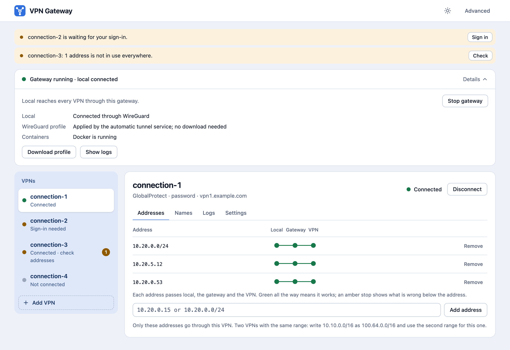

# VPN Gateway

**All your organization VPNs, open at the same time, on your own computer.**

Consultants, freelancers and support teams often need the internal networks of several organizations in one day.
Each one hands out its own VPN, and you can be connected to only one at a time. VPN Gateway keeps every VPN open
side by side, and one page in your browser shows them all.



*The names, hosts and addresses in this picture are made up.*

## What it does

- **Several VPNs at once:** Palo Alto GlobalProtect and Fortinet FortiGate, with a password or a single sign-on page.
- **One page for everything:** connect, sign in, add a VPN and change its addresses, with no config files.
- **Only what you choose goes through a VPN:** you list the addresses; your normal internet stays as it is.
- **See what works:** each address shows three stops, from your computer through the gateway into the VPN.
- **Mac and Windows:** runs on Docker Desktop and WireGuard, both free. Nothing goes to a cloud service.

## Before you start

> [!IMPORTANT]
> Use VPN Gateway only for networks you are allowed to use. Some organizations allow no other VPN app, require a
> managed device or a device health check (GlobalProtect HIP), or forbid other connections at the same time. If you
> are not sure, ask their IT team.

## Get started

1. Install **Docker Desktop**, **WireGuard**, **Git** and **Python**.
2. Download VPN Gateway and start the page:

   ```sh
   git clone https://github.com/tariktekin8/vpn-gateway.git
   cd vpn-gateway
   ./vpn web
   ```

   On Windows, run `.\vpn.cmd web`.
3. On the page, press **Start the gateway**, connect the WireGuard tunnel, add your VPNs and press **Connect**.

Step by step, with a flowchart for each system: [Setup on a Mac](docs/technical.md#setup-on-a-mac) and
[Setup on Windows](docs/technical.md#setup-on-windows).

## Security

- Each organization's VPN runs apart; none can reach another or open a connection to your computer.
- Passwords are asked at every connect and never stored. Passwords and login cookies never reach a file or a log.
- The page works only on your computer, and only with the link that `./vpn web` prints.
- It cannot protect a compromised computer, which reaches every connected organization at once.

Details: [Security notes](docs/technical.md#security-notes).

## Update

`./vpn web` and the page tell you when a new version is out. Read the [changelog](CHANGELOG.md), stop `./vpn web`,
run `git pull` and start it again: [Update](docs/technical.md#update).

## Documentation

- [Documentation](docs/technical.md): setup, everyday use, names (DNS), command line, how it works, security.
- [Changelog](CHANGELOG.md): what each version added.
- [Contributing](CONTRIBUTING.md) and [Adding a VPN client](docs/adding-a-vpn-client.md).
- [Security policy](SECURITY.md): how to report a vulnerability.

## License

[MIT](LICENSE). VPN Gateway is not affiliated with Palo Alto Networks, Fortinet or WireGuard. It uses
[openconnect](https://www.infradead.org/openconnect/), [openfortivpn](https://github.com/adrienverge/openfortivpn)
and [WireGuard](https://www.wireguard.com/), each under its own license.
