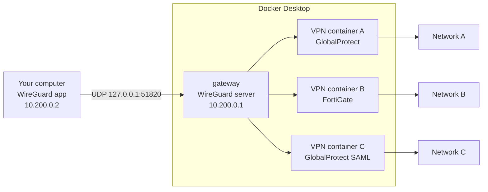

# VPN Gateway documentation

Everything about VPN Gateway: how to install and use it, what it changes on your computer, the command line, the
configuration file, and how it works inside. The [README](../README.md) is the short introduction.



- One JSON file (`data/systems.json`) lists every VPN. The web page writes it; you can also edit it by hand.
- Each VPN runs in its own Docker container. A WireGuard gateway container sits in front of them. Your computer
  makes one WireGuard connection to the gateway, and the gateway sends each packet into the right VPN.
- There is a local web page (`./vpn web`) and a command line tool (`./vpn`). Both do the same work.

## Contents

**Part 1: Use it**

- [Before you start](#before-you-start)
- [Supported VPNs](#supported-vpns)
- [What you need](#what-you-need)
- [Install (Mac)](#install-mac)
- [Install (Windows)](#install-windows)
- [First setup on the page](#first-setup-on-the-page)
- [Every day](#every-day)
- [Reaching servers by name](#reaching-servers-by-name)
- [Things to keep in mind](#things-to-keep-in-mind)
- [System files VPN Gateway changes](#system-files-vpn-gateway-changes)
- [Stop or remove](#stop-or-remove)

**Part 2: Reference**

- [Web page](#web-page)
- [Configure your VPNs (systems.json)](#configure-your-vpns-systemsjson)
- [First start (command line)](#first-start-command-line)
- [Log in to each VPN (command line)](#log-in-to-each-vpn-command-line)
- [Everyday commands](#everyday-commands)
- [Sign-in helper (Mac)](#sign-in-helper-mac)
- [Automatic tunnel (Mac)](#automatic-tunnel-mac)
- [Windows specifics](#windows-specifics)
- [How it works](#how-it-works)
- [Troubleshooting](#troubleshooting)
- [Security notes](#security-notes)
- [Known limits](#known-limits)
- [Development](#development)

---

# Part 1: Use it

## Before you start

> [!IMPORTANT]
> Use VPN Gateway only for networks you are allowed to use. Check each organization's rules first:
>
> - Some organizations allow no VPN app other than their own.
> - Some require a managed device or a device health check (GlobalProtect HIP); VPN Gateway does not send one.
> - Some contracts forbid being connected to other networks at the same time.
>
> If you are not sure, ask their IT team.

## Supported VPNs

| `method`      | VPN                         | Login                                              | Client in the container |
|---------------|-----------------------------|----------------------------------------------------|-------------------------|
| `gp-password` | Palo Alto GlobalProtect     | user name and password (asked at every connect), plus MFA | openconnect             |
| `gp-saml`     | Palo Alto GlobalProtect     | SAML single sign-on in your browser                | openconnect             |
| `forti-saml`  | Fortinet FortiGate SSL VPN  | SAML single sign-on in your browser                | openfortivpn            |

## What you need

A few free programs. Install them once.

| | Mac | Windows |
|---|---|---|
| **Docker Desktop** runs each VPN in the background | <https://www.docker.com/products/docker-desktop/> | <https://www.docker.com/products/docker-desktop/> |
| **WireGuard** connects your computer to VPN Gateway | [Mac App Store](https://apps.apple.com/app/wireguard/id1451685025) | <https://www.wireguard.com/install/> |
| **Git** downloads VPN Gateway | Comes with the Mac developer tools (see below) | <https://git-scm.com/download/win> |
| **Python** runs VPN Gateway | Comes with the Mac developer tools | <https://www.python.org/downloads/windows/> |

After installing Docker Desktop, open it once and wait until it says it is running.

More about the requirements:

- macOS on Apple silicon or Intel, or Windows 10/11. The containers are Linux, so the gateway itself also runs on
  Linux.
- Docker Desktop must include `docker compose` and must be running while you use VPN Gateway. On Windows it uses
  the **WSL 2** backend (the default).
- Python 3.9 or later. VPN Gateway uses only the standard library, so there is nothing to `pip install`.
- Only for the [sign-in helper on a Mac](#sign-in-helper-mac): the Xcode Command Line Tools
  (`xcode-select --install`).

## Install (Mac)

Open the **Terminal** app (press Cmd-Space, type "Terminal", press Enter). Copy each line below, paste it into
Terminal, and press Enter.

1. If you have never used Git on this Mac, type `git --version` and press Enter. If the Mac offers to install the
   developer tools, accept and wait until they are installed. This also installs Python.

2. Download VPN Gateway:

   ```sh
   git clone https://github.com/tariktekin8/vpn-gateway.git
   cd vpn-gateway
   ```

3. Start VPN Gateway:

   ```sh
   ./vpn web
   ```

4. Open <http://127.0.0.1:8765/> in your browser. This is your VPN Gateway page.

Keep the Terminal window open while you use the page. To stop the page, press Ctrl-C in Terminal. Your VPN
connections keep running.

To check that the tools work, run `docker compose version`, `python3 --version` and `./vpn --help`.

**Next time**, you only need steps 3 and 4, from the `vpn-gateway` folder:

```sh
cd vpn-gateway
./vpn web
```

## Install (Windows)

1. Install the four programs from [What you need](#what-you-need):
   - **Docker Desktop**: keep the default **WSL 2** option. Restart the PC if it asks. Open Docker Desktop once.
   - **WireGuard for Windows**.
   - **Python**: on the first screen of the installer, tick **Add python.exe to PATH** and keep **py launcher**
     selected.
   - **Git for Windows**: the default options are fine. The repository's `.gitattributes` keeps the container
     scripts in Unix line endings, so they run.
2. Open **PowerShell**: press the Windows key, type "PowerShell", press Enter.
3. Copy each line below, paste it into PowerShell (right-click pastes), and press Enter:

   ```powershell
   cd $HOME
   git clone https://github.com/tariktekin8/vpn-gateway.git
   cd vpn-gateway
   .\vpn.cmd web
   ```

   The folder must stay inside your user folder (`C:\Users\<you>\vpn-gateway`): Windows keeps it private to you
   there. Do not move it to a shared folder.
4. Open <http://127.0.0.1:8765/> in your browser. This is your VPN Gateway page.

Keep the PowerShell window open while you use the page. To stop the page, press Ctrl-C in PowerShell.

**Next time**, open PowerShell and run:

```powershell
cd $HOME\vpn-gateway
.\vpn.cmd web
```

## First setup on the page

Nothing to configure by hand: VPN Gateway creates its `data/` folder, the compose file and the WireGuard keys
itself. The command line does the same work; see [First start (command line)](#first-start-command-line).

1. Press **Start the gateway**. The first time takes a few minutes.
2. Press **Download profile**. Open the WireGuard app, choose **Import tunnel(s) from file**, pick the downloaded
   `vpn-gateway.conf` and turn it on. Your computer is now connected to VPN Gateway.
3. Press **Add VPN** and fill in one VPN (see below). Repeat for each VPN.

### What to fill in

Ask the IT team that gave you the VPN, or look at the settings of the VPN app they gave you.

| Field | What to write |
|---|---|
| **Name** | A short name for yourself, for example `connection-1`. Starts with a small letter; then small letters, numbers and `-`; at most 31 characters. `gateway` is taken. |
| **Method** | `gp-password`: GlobalProtect with a user name and password. `gp-saml`: GlobalProtect that opens a sign-in page. `forti-saml`: FortiGate (FortiClient) that opens a sign-in page. |
| **Host** | The VPN address, for example `vpn1.example.com`. Add `:port` if they gave you a port, for example `vpn3.example.com:10443`. |
| **User** | Your VPN user name (only for `gp-password`). |
| **Subnets** | The addresses you want to reach through this VPN, one per line, for example `10.20.0.15`. **Only these go through the VPN; nothing else does.** Add the VPN's DNS server too if you want to use names. If two VPNs use the same addresses, write `10.10.0.0/16 as 100.64.0.0/16` for one of them and use the second range to reach it. |

## Every day

1. Make sure Docker Desktop is running.
2. Start the page (`./vpn web` in Terminal, `.\vpn.cmd web` in PowerShell) and open
   <http://127.0.0.1:8765/>.
3. The page shows your VPNs in a list on the left. Pick one and press **Connect**, then log in:
   - **Password VPNs:** type your password in the box that opens and press **Connect**. VPN Gateway asks for it
     every time and never stores it. Approve the sign-in on your phone if the VPN asks, or type the code in the
     **Code** box.
   - **Sign-in page VPNs:** a small window opens with the VPN's sign-in page. Sign in as usual. The window
     closes by itself when you are connected.
     For GlobalProtect sign-in pages (`gp-saml`), install a small helper once so this works by itself:
     on a Mac, the [sign-in helper (Mac)](#sign-in-helper-mac); on Windows, the
     [sign-in helper (Windows)](#sign-in-helper-windows). Without the helper, the VPN's page shows you how to copy
     a link by hand.
4. A green dot means connected. Anything that needs you (a sign-in, an error, an address that does not work) shows
   in a strip at the top of the page, with a button that takes you there.

To see or change the addresses a VPN reaches, open its **Addresses** tab. Each address shows three stops, which
must all be green: **local** sends it into the tunnel, the **gateway** sends it to the right VPN, and the
**VPN** passes it on. Add or remove an address there; it applies at once, also to a connected VPN.

VPN sessions end after some hours, as the organization sets them. When a VPN's dot is no longer green, press
**Connect** again.

When the top strip says **Your WireGuard profile changed**, press **Download profile** and import it again in
WireGuard (it asks to replace the old one). This only happens when you change the addresses of a VPN. On a
Mac you can make this automatic: see [Automatic tunnel (Mac)](#automatic-tunnel-mac).

## Reaching servers by name

Every address you list in a VPN's **Subnets** works by its number, for example `10.20.0.15`. To use names such as
`server.corp1.example.com`, the VPN's **DNS server** must be in its Subnets too. The VPN's **Names** tab shows its
domains and DNS servers, and adds a server to the Subnets with one click.

**Mac with the [automatic tunnel](#automatic-tunnel-mac):** names work by themselves. VPN Gateway learns each
VPN's DNS when it connects and writes `/etc/resolver/<domain>` within 5 seconds; it deletes the file when the VPN
disconnects. It only touches files whose first line is `# managed by vpn-gateway`, so a file you wrote yourself
stays as it is: delete your own file if you want VPN Gateway to take over that domain. Every domain and address is
checked first: the domain needs at least one dot (never a whole top-level domain) and only letters, digits, `-` and
dots; the servers must be IPv4 addresses.

**Mac without the automatic tunnel:** create one file per domain, once (it asks for your Mac password):

```sh
sudo mkdir -p /etc/resolver
echo "nameserver 10.20.0.53" | sudo tee /etc/resolver/corp1.example.com
```

Replace `10.20.0.53` with the DNS server and `corp1.example.com` with the domain. Check it with
`scutil --dns | grep -A3 corp1.example.com`. Remove it with `sudo rm /etc/resolver/corp1.example.com`.

**Windows:** add a Name Resolution Policy Table (NRPT) rule, once. Open PowerShell **as administrator**
(right-click PowerShell, **Run as administrator**) and run:

```powershell
Add-DnsClientNrptRule -Namespace ".corp1.example.com" -NameServers "10.20.0.53"
Get-DnsClientNrptRule                                   # list the rules
Get-DnsClientNrptRule | Where-Object Namespace -eq ".corp1.example.com" | Remove-DnsClientNrptRule -Force
```

On a Mac, names that end in `.local` go to Bonjour (mDNS) first. Reach those servers by their address.

## Things to keep in mind

- Keep Terminal (PowerShell on Windows) open with `vpn web` running while you use the page.
- Docker Desktop must be running.
- The tunnel must be on in the WireGuard app. To refresh it, turn it off and on.
- Allow pop-ups for the page: sign-in windows open as pop-ups.
- Ports 51820 (UDP) and 8020 (TCP) on `127.0.0.1` must be free: quit the official FortiClient and other WireGuard
  tunnels first.
- Sign in to one FortiGate VPN at a time: FortiGate sign-ins share port 8020.
- Test an address with the program you need (browser, SAP, remote desktop). Many networks block ping.
- A VPN's **Logs** tab shows what it is doing. Check log lines for user names and addresses before you share them.

## System files VPN Gateway changes

The normal setup writes only inside the `vpn-gateway` folder and in Docker Desktop. It changes no system file.
System files change only when you install one of these optional parts, or set up DNS by hand:

### System files on a Mac

| Part | System files it writes | Removed by |
|---|---|---|
| Automatic tunnel (`sudo handlers/macos/install-tunnel.sh`, runs as root) | `/Library/LaunchDaemons/com.athenayazilim.vpn-gateway.tunnel.plist` (a background service)<br>`/usr/local/libexec/vpn-gateway-tunnel` (the service's script)<br>`/etc/wireguard/vpn-gateway.conf` (a copy of the WireGuard profile)<br>`/etc/resolver/<domain>` (one file per VPN domain, marked `# managed by vpn-gateway`)<br>`/var/log/vpn-gateway.log` (its log) | `sudo handlers/macos/uninstall-tunnel.sh` removes all but the log; delete the log with `sudo rm /var/log/vpn-gateway.log` |
| Sign-in helper (`handlers/macos/install.sh`) | `~/Applications/VPN Gateway Callback.app`, registered with macOS to open `globalprotectcallback:` links | `handlers/macos/uninstall.sh` |
| DNS by hand ([Reaching servers by name](#reaching-servers-by-name)) | The `/etc/resolver/<domain>` files you create | `sudo rm /etc/resolver/<domain>` |

The automatic tunnel also needs `wireguard-tools` from Homebrew (`brew install wireguard-tools`).

### System files on Windows

| Part | System files it writes | Removed by |
|---|---|---|
| Sign-in helper (`handlers\windows\install.ps1`) | Registry key `HKCU\Software\Classes\globalprotectcallback` (your user only) | `handlers\windows\uninstall.ps1` |
| DNS by hand ([Reaching servers by name](#reaching-servers-by-name)) | The NRPT rules you add | `Remove-DnsClientNrptRule` |

## Stop or remove

- To disconnect one VPN, press **Disconnect**. To stop everything, choose **Advanced**, **Stop all connections**.
- To remove VPN Gateway:
  1. Choose **Stop all connections**, and delete the `vpn-gateway` tunnel in the WireGuard app.
  2. Remove the optional parts you installed (see [System files](#system-files-vpn-gateway-changes)).
  3. Remove the Docker parts (Terminal or PowerShell):

     ```sh
     docker compose -p vpn-gateway down --volumes
     docker image rm vpn-gateway vpn-openconnect vpn-openfortivpn
     ```

  4. Delete the `vpn-gateway` folder. Its `data/` folder holds your settings and WireGuard keys; it is deleted with it.

---

# Part 2: Reference

## Web page

```sh
./vpn web              # http://127.0.0.1:8765/
./vpn web --port 9000
```

The page has two panes: the list of VPNs on the left, each with its state, and the chosen VPN on the right, with a
Connect or Disconnect button, the login steps and four tabs: **Addresses**, **Names** (DNS), **Logs** and
**Settings** (edit or delete). A strip at the top lists what needs you (a login, an error, an address that does not
work, a changed profile). A bar above the VPNs always shows the gateway's state; open its **Details** for the
gateway's facts, Start/Stop, the profile download and **Show logs**. The profile download and **Stop all
connections** are also under **Advanced**. The theme button switches between System, Light and Dark. Ctrl-C stops
the server; the containers keep running.


- **Addresses** lists every address of the VPN and whether local (`route -n get` on a Mac, the best route on
  Windows), the gateway (`ip route` in the gateway container) and the VPN container (`/state/<name>.routes`) use it.
  Adding or removing an address there, or changing subnets in **Settings**, saves `systems.json` and gives a
  connected VPN its new list at once: the page starts the container's `hub-link.sh` again with the new
  `VPN_SUBNETS` and stops the old one, so the VPN session stays up. The automatic tunnel applies the new profile
  within 5 seconds.
- **Names** lists the domains and DNS servers the VPN pushed, and whether each server is in Addresses.
- **Download profile** saves the gateway's profile as `vpn-gateway.conf`. The page remembers (in this browser
  only) which version you downloaded and says so in the top strip when the gateway writes a new one. The file holds
  a private key: do not share it.
- The server reads `data/systems.json` again on every request, so edits by hand or by the command line show up at
  once. If `data/systems.json` is broken, the page shows the error and refuses to save until you fix the file by
  hand.
- `forti-saml`: Connect opens a pop-up. When the container prints its "Authenticate at" address, the page loads it
  into the pop-up. After the login FortiGate sends the browser to `http://127.0.0.1:8020/`; the gateway passes it to
  the FortiGate VPN whose login runs now, and the page closes the pop-up when the tunnel is up. The "Authenticate
  at" link stays on the VPN's page as the fallback. The page says when another FortiGate login holds the port.
- `gp-saml`: the login runs in a browser pop-up that the page opens. The server answers Connect with a
  `popup_url`: the IdP address (REDIRECT gateways) or a one-time `/saml/<nonce>` page that holds the gateway's
  auto-submitting login form (POST gateways). The login ends on a `globalprotectcallback:` link. The sign-in helper
  hands it to the server; without the helper, paste the link on the VPN's page.
- A pop-up blocker can stop the login pop-up; the page then offers a link. After a page reload, or on login sites
  that set `Cross-Origin-Opener-Policy`, close the login pop-up by hand.

## Configure your VPNs (`systems.json`)

The web page writes `data/systems.json` for you. To edit it by hand instead, copy the example and open it in an
editor:

```sh
mkdir -m 700 data
cp systems.example.json data/systems.json
chmod 600 data/systems.json
```

On Windows: `mkdir data`, `copy systems.example.json data\systems.json`, `notepad data\systems.json`.

`data/systems.json` holds a list of `systems`. Each system is one VPN:

```json
{
  "systems": [
    {
      "name": "connection-1",
      "method": "gp-password",
      "host": "vpn1.example.com",
      "user": "jdoe",
      "subnets": ["10.10.0.0/16"]
    },
    {
      "name": "connection-2",
      "method": "gp-saml",
      "host": "vpn2.example.com",
      "subnets": ["172.20.5.10", "172.20.5.11"]
    },
    {
      "name": "connection-3",
      "method": "forti-saml",
      "host": "vpn3.example.com:10443",
      "subnets": []
    }
  ]
}
```

| Field      | Needed for                 | Meaning |
|------------|----------------------------|---------|
| `name`     | all                        | Short id: a lower-case letter, then lower-case letters, digits and `-`; at most 31 characters. It names the container (`vpn-<name>`). `gateway` is reserved. |
| `method`   | all                        | One of the methods in [Supported VPNs](#supported-vpns). |
| `host`     | all                        | VPN address, as you would type it in the official client. Add `:port` if it is not 443. |
| `user`     | `gp-password`              | Your VPN user name. |
| `subnets`  | optional                   | What your computer sends into this VPN. See below. |

**About `subnets`:**

- List what you need: networks (`10.10.0.0/16`) or single servers (`10.10.1.5`, saved as `/32`).
- **Only these addresses go through the VPN.** The routes the VPN server pushes are ignored, and a system with
  empty `subnets` (`[]`) reaches nothing. The gateway enforces this with a firewall allow-list, and a listed range
  whose VPN is not connected is dropped, never sent out through the normal internet.
- Nothing on the VPN side can open a connection to your computer; only replies come back.
- To use names, also list the VPN's DNS server (see [Reaching servers by name](#reaching-servers-by-name)).
- Two systems may not list overlapping subnets. `./vpn check` refuses that, and suggests the fix below.
- **Two VPNs with the same range:** write the entry as `"<real range> as <shown range>"` for one of them, for
  example `"10.10.0.0/16 as 100.64.0.0/16"`. Your computer then reaches that VPN's `10.10.x.y` at `100.64.x.y`:
  its container maps each address one to one (`iptables` NETMAP) and maps replies back. Both ranges must be IPv4
  and the same size. Pick a shown range no VPN uses; `100.64.0.0/10` (shared address space) is a good place. The
  shown range is what goes into the WireGuard profile and the overlap check. Names from that VPN's DNS resolve to
  the real addresses, so reach that VPN by the shown addresses. A DNS server inside a mapped real range is reached
  at its real address, which takes that one address away from the other VPN.
- `"TODO"` is accepted as a placeholder and ignored.
- If a range clashes with your home or office network (for example `192.168.0.0/16` against your Wi-Fi's
  `192.168.1.0/24`), list the narrower ranges you need.

**About passwords:** `data/systems.json` holds no password, cookie or token; VPN Gateway refuses one there. It asks
for a `gp-password` password at every connect and sends it straight into the VPN container (see
[Security notes](#security-notes)). A file from an older version that still holds `password` is cleaned at the
next start: the password is removed from `systems.json`, and old password and cookie files in `data/secrets/` are
deleted. Everything VPN Gateway writes lives in `data/`, which is git-ignored. Never commit it.

Validate the file at any time:

```sh
./vpn check
```

## First start (command line)

1. Start the gateway and all VPN containers (with no systems yet, only the gateway starts):

   ```sh
   ./vpn up
   ```

   The first run builds the images and takes a few minutes. VPN Gateway regenerates
   `data/docker-compose.generated.json` from `data/systems.json` on every run, so you never edit the compose file.

2. Log in to each VPN (next section). A VPN shares its routes with the gateway only after it is connected.

3. Import the profile into WireGuard. The gateway writes it to `data/wireguard/mac.conf` (the same name on every
   system): open the WireGuard app, choose **Import tunnel(s) from file**, pick `data/wireguard/mac.conf`, then
   **Activate**. On a Mac, `open data/wireguard` shows the folder in Finder.

4. Check the state:

   ```sh
   ./vpn status
   ```

   ```text
   gateway       wireguard    running      Mac connected
   connection-1  gp-password  running      tun0 up, 1 routes to Mac
   connection-2  gp-saml      running      tun0 up, 2 routes to Mac
   connection-3  forti-saml   running      ppp0 up, 3 routes to Mac
   ```

   "Mac" in this output means your computer, on Windows too.

> **Import the WireGuard profile again when it changes.** The profile always holds every `subnets` entry from
> `data/systems.json` and nothing else, so it changes only when you edit `subnets`, never when a VPN connects or
> disconnects. The WireGuard app does not reload the file by itself. While a VPN is off, its addresses still
> enter the tunnel and are dropped at the gateway. The web page's top strip tells you when this is needed; in the
> terminal, the gateway log shows the new list: `docker logs vpn-gateway | tail -1`. The
> [automatic tunnel](#automatic-tunnel-mac) does this for you on a Mac.

## Log in to each VPN (command line)

```sh
./vpn login <name>
```

This starts the gateway and that one VPN container, then walks you through the login. When the tunnel is up you
can press Ctrl-C: that only stops following the log, the tunnel stays up.

### `gp-password`

- VPN Gateway asks for the password (the input is hidden) and sends it into the container. Approve the MFA push on
  your phone if asked.
- If the log asks for a code, run `./vpn type <name>` in a second terminal and type it.

### `gp-saml`

1. VPN Gateway opens the SAML login page of the gateway in your default browser.
2. **Before you log in**, open the browser's developer tools (Cmd-Opt-I on a Mac, F12 on Windows) on the Console
   tab.
3. Log in as usual (company SSO, MFA).
4. At the end the page tries to open a link that starts with `globalprotectcallback:`. Copy that whole link from
   the Console error or the browser's prompt.
5. Paste it into the terminal and press Enter. The input is hidden on purpose: the link holds a session cookie.
   Never paste it into a chat or a ticket.

The web page with the sign-in helper ([Mac](#sign-in-helper-mac), [Windows](#sign-in-helper-windows)) catches the
link for you, so you skip steps 2, 4 and 5. The command line always asks you to paste it.

### `forti-saml`

1. The container prints an `Authenticate at` address. Open it in your browser.
2. Log in as usual. At the end FortiGate sends the browser to `http://127.0.0.1:8020/`. The gateway serves that port
   and passes it to the FortiGate system whose login runs now, so several `forti-saml` systems work, one login at
   a time: the last one started gets the port. Nothing to copy.

## Everyday commands

```sh
./vpn check            # validate data/systems.json and regenerate the compose file
./vpn up [name...]     # start containers (all if no name) and the gateway; a gp-password one waits for login
./vpn login <name>     # start one system and log in
./vpn type <name>      # send a code (MFA) to a system that asks for one
./vpn status           # container, tunnel and route state per system
./vpn down [name...]   # stop containers (all if no name)
docker logs -f vpn-<name>   # follow one VPN's log
```

On Windows, use `.\vpn.cmd` in place of `./vpn`; it works in Command Prompt and PowerShell.

When a VPN session ends (the organization sets how long it lasts), run `./vpn login <name>` again.

## Sign-in helper (Mac)

`VPN Gateway Callback` is a tiny Mac app that receives `globalprotectcallback:` links and forwards them to the
running `./vpn web` (`POST /handler/callback` on 127.0.0.1). It shows nothing when it works and an alert when it
fails. It is one Swift file (`handlers/macos/CallbackHandler.swift`), built on your Mac with the Xcode Command Line
Tools.

```sh
xcode-select --install                   # once, if you do not have the Command Line Tools
handlers/macos/install.sh                # build, sign ad hoc, register ~/Applications/VPN Gateway Callback.app
handlers/macos/install.sh --take-over    # the same, and make it the default even when GlobalProtect is installed
handlers/macos/uninstall.sh              # unregister and delete it
```

- The first time a login hands over a link, the browser asks "Open VPN Gateway Callback?". Allow it.
- If the official GlobalProtect app is installed, it owns `globalprotectcallback:` links. `install.sh` then
  installs VPN Gateway Callback without making it the default, unless you pass `--take-over`.
  **Taking over breaks the official app's browser login** until you run `handlers/macos/uninstall.sh`.
- The app stores the absolute path of this folder's `data/secrets/web-handler.json`. Run
  `handlers/macos/install.sh` again if you move the folder.
- If the folder is under Documents, Desktop or Downloads, macOS asks whether VPN Gateway Callback may access it.
  Allow it, so it can read the handler file.
- Some Command Line Tools releases fail with `redefinition of module 'SwiftBridging'`. `install.sh` works around
  this with a compiler overlay; it does not change system files.
- `./vpn web` must be running when the link arrives. When two `gp-saml` logins wait at once, the helper refuses (it
  never guesses): paste the link on the right VPN's page. Only the last started `./vpn web` owns
  `data/secrets/web-handler.json`; the helper talks to that one. If the web server restarts during a login, start
  the login again.

## Automatic tunnel (Mac)

Instead of importing the profile in the WireGuard app, VPN Gateway can run the tunnel itself with `wg-quick` as a
system service. It brings the tunnel up at boot, and applies a new profile within 5 seconds of the gateway writing
it, so you never download or import again. It also sets up names for the VPNs (see
[Reaching servers by name](#reaching-servers-by-name)).

```sh
brew install wireguard-tools                 # as your user: wg, wg-quick, wireguard-go
sudo handlers/macos/install-tunnel.sh        # once; asks for your password
sudo handlers/macos/uninstall-tunnel.sh      # remove it
```

- Then turn off (or delete) the vpn-gateway tunnel in the WireGuard app, and do not import the profile there again.
  Two clients with the same key fight each other and nothing gets through. If it happens anyway, the service
  notices within 5 seconds that the gateway address left its tunnel and sets the tunnel up again.
- The service is a launchd daemon (`com.athenayazilim.vpn-gateway.tunnel`) that runs
  `/usr/local/libexec/vpn-gateway-tunnel` as root. Its log is `/var/log/vpn-gateway.log`. The gateway bar on the
  web page says when it is active (open its **Details**).
- It writes and removes `/etc/resolver/<domain>` files for the DNS of connected VPNs; `uninstall-tunnel.sh`
  removes the ones it wrote.
- The tunnel is called `vpn-gateway` (`sudo wg show` lists it under its `utun` name). Its config is a cleaned copy
  at `/etc/wireguard/vpn-gateway.conf`.
- Security: wg-quick runs `PreUp`/`PostUp` lines as root, and the profile sits in a folder your user can write.
  The service therefore never uses the profile as is: it copies only the keys, the address, `AllowedIPs`, the
  keepalive and an endpoint on `127.0.0.1`. It still runs Homebrew's `wg-quick` and `wireguard-go` as root, which
  any process running as your user could replace; this is the usual trade-off of `sudo wg-quick` with Homebrew.
- Run `install-tunnel.sh` again if you move the project folder: the service holds the path of
  `data/wireguard/mac.conf`.

## Windows specifics

Everything else works the same way on Windows.

- Commands: `.\vpn.cmd` in place of `./vpn`.
- Names: NRPT rules instead of `/etc/resolver` (see [Reaching servers by name](#reaching-servers-by-name)).
- Files: Windows has no `chmod 600`. `data\` (settings and WireGuard keys) stays private because files in your
  user folder are readable only by you and the administrators. Keep the project there.

### Sign-in helper (Windows)

`handlers\windows\callback.pyw` does what the Mac app does: Windows starts it for `globalprotectcallback:` links,
and it forwards them to the running `vpn web`. It is plain Python, so there is nothing to build. It is registered
for your Windows user only (under `HKEY_CURRENT_USER`), with no administrator rights.

```powershell
powershell -ExecutionPolicy Bypass -File handlers\windows\install.ps1              # register it
powershell -ExecutionPolicy Bypass -File handlers\windows\install.ps1 -TakeOver    # also when GlobalProtect is installed
powershell -ExecutionPolicy Bypass -File handlers\windows\uninstall.ps1            # remove it
```

- If the official GlobalProtect app is installed, `install.ps1` changes nothing unless you pass `-TakeOver`.
  **Taking over breaks the official app's browser login** until you run `handlers\windows\uninstall.ps1`.
- The registry entry holds the absolute path of the script. Run `install.ps1` again if you move the folder.
- The first time a login hands over a link, the browser asks whether to open it. Allow it.

## How it works

1. `./vpn` reads `data/systems.json`, checks it and writes
   `data/docker-compose.generated.json`: one service per system plus the `gateway` service.
2. Each VPN container runs its client (openconnect or openfortivpn) with `NET_ADMIN` and `/dev/net/tun`.
   A helper script (`docker/common/hub-link.sh`) adds NAT on the tunnel interface and writes the routes it serves
   to a shared volume, `/state/<name>.routes`, every 5 seconds: the `subnets` from `data/systems.json` (the shown
   side of an `as` mapping), never the routes the VPN pushed. Its firewall drops connections opened from the VPN
   side. It also publishes the DNS the VPN pushed to `/state/<name>.dns` (openconnect: from the `resolv.conf`
   vpnc-script writes in the container; openfortivpn: from its "Got addresses … ns […], ns_suffix […]" log line).
3. The gateway (`docker/gateway/entrypoint.sh`) runs WireGuard on `10.200.0.1/24` and publishes UDP 51820 on
   `127.0.0.1` only. Every 5 seconds it reads `/state/*.routes`, routes each network to the container that serves
   it, and rewrites `data/wireguard/mac.conf`. Its `AllowedIPs` hold the `subnets` from `systems.json` (VPN Gateway
   writes them to `data/wireguard/static-routes`) and nothing else. The same list is the gateway's firewall
   allow-list; a listed range without a connected VPN gets an `unreachable` route, so it never leaks out through
   Docker's network. It collects the DNS of all VPNs into `data/wireguard/dns` ("domain server…" lines), keeping
   only servers inside `subnets`.
4. On your computer, WireGuard sends only those networks into the tunnel. Everything else uses your normal
   connection.

```text
.
├── vpn                        launcher: ./vpn <command>, ./vpn web (vpn.cmd on Windows)
├── src/
│   ├── cli.py                 command line (Python, standard library only)
│   └── server.py              web API, reuses the command line's code
├── web/                       web page: index.html, style.css, app.js (built from web/src/app.ts)
├── package.json, tsconfig.json  TypeScript build for the web page only
├── docker/
│   ├── gateway/               WireGuard gateway image
│   ├── openconnect/           GlobalProtect client image
│   ├── openfortivpn/          FortiGate client image
│   └── common/hub-link.sh     shares a tunnel's routes and DNS with the gateway
├── handlers/
│   ├── macos/                 sign-in helper for macOS (Swift), automatic tunnel, install scripts
│   └── windows/               sign-in helper for Windows (Python) and its install scripts
├── systems.example.json       example config; copy to data/systems.json
└── data/                      created by VPN Gateway (or you); git-ignored
    ├── systems.json           your VPNs (no passwords)
    ├── docker-compose.generated.json
    ├── secrets/               sign-in helper token while vpn web runs; SAML login page from ./vpn login
    └── wireguard/             WireGuard keys, mac.conf, static-routes, dns
```

## Troubleshooting

**`./vpn status` says "no routes to Mac".** The VPN is not logged in yet. Run `./vpn login <name>`.

**The tunnel is up, but your computer reaches nothing.**
1. Import `data/wireguard/mac.conf` (or the downloaded `vpn-gateway.conf`) in the WireGuard app again and activate
   it. This is the most common cause.
2. Check that your computer uses the tunnel for that address. Mac: `route -n get <ip>` shows a `utun` interface.
   Windows: `Find-NetRoute -RemoteIPAddress <ip>` shows the WireGuard interface.
3. Check that the gateway sends it to the right container: `docker exec vpn-gateway ip route get <ip>`.
4. Test a real port instead of ping, for example `nc -vz <ip> 443` on a Mac or
   `Test-NetConnection <ip> -Port 443` on Windows.

**Two VPNs use the same range (for example `10.0.0.0/8`).** The gateway sends a range to one container only.
List only the addresses you need in each system's `subnets`. If both really use the same addresses, reach one of
them under another range: `"10.10.0.0/16 as 100.64.0.0/16"` (see
[Configure your VPNs](#configure-your-vpns-systemsjson)).

**`gp-password` keeps asking for the password, or the log shows `512`.** The VPN refused the password. Disconnect,
then connect again and type it carefully. If it asks for a code, type it in the **Code** box (or
`./vpn type <name>`).

**`gp-saml` login fails with a "512" or asks for the cookie again.** SAML cookies work once. Run
`./vpn login <name>` again and paste the new link.

**Port 51820 or 8020 is already in use.** Another WireGuard tunnel or FortiClient uses it. Quit it, or stop the
other tunnel.

## Security notes

- VPN Gateway listens on `127.0.0.1` only: the WireGuard port, the FortiGate SAML port and the web page.
- Passwords and SAML cookies are never stored. The page (or `./vpn login`) asks for the password at every connect.
  The server keeps it in memory only until it sends it, together with a SAML cookie or an MFA code, into the VPN
  container: through `docker exec -i` into a pipe (FIFO) in a memory-only folder (`/run/vpn`, tmpfs). It never
  reaches a file, the compose file, an argument list, the environment or a log.
- WireGuard private keys stay in `data/wireguard/` (mode 600). `mac.conf` and the downloaded `vpn-gateway.conf`
  contain your computer's private key: do not share them.
- GlobalProtect may ask for a device health report (HIP). VPN Gateway does not send one, so the organization's
  firewall may limit what you can reach; a policy that requires a managed device applies to you anyway (see
  [Before you start](#before-you-start)).
- Container logs show what the VPN clients print. VPN Gateway does not filter them. Check them before you share
  them.
- Web page:
  - At startup the server makes a random token and puts it into the page when it serves it. Every `/api/` request
    must send it in `X-Gateway-Token`. A restart makes a new token, so reload the page after a restart.
  - The `Host` header must be `127.0.0.1:<port>` or `localhost:<port>`, and an `Origin` header, if any, must
    match it. This blocks other websites and DNS rebinding. No CORS headers are sent.
  - POST and PUT must use `Content-Type: application/json`; bodies are capped at 64 KB.
  - The API never returns or stores passwords. The request log holds the method and path, without query strings or
    bodies.
  - A POST gateway's SAML login form is kept in memory only and served once at `/saml/<nonce>` (random, valid for
    5 minutes). It is served with a sandbox Content-Security-Policy without `allow-same-origin`, so it cannot read
    the page token, and with `Referrer-Policy: no-referrer`. The log shows the path as `/saml/-`.
  - The sign-in helper uses a separate random token, stored while the server runs in
    `data/secrets/web-handler.json` (mode 600, with the port). It works only for `/handler/callback`.
    The server deletes the file on exit if the file still holds its token.
  - There is no login screen. The page at `http://127.0.0.1:<port>/` holds the API token, so **any user or process
    on this computer** that can open a local port can use the whole API while the server runs. Run `./vpn web`
    only when you need it, on a computer you do not share, and stop it with Ctrl-C afterwards.
  - Any website can try to open a `globalprotectcallback:` link. While a `gp-saml` login waits, a forged link would
    replace your login with someone else's session for that VPN host. Only start a login when you are about to do
    it.

## Known limits

- One FortiGate SAML login at a time: they share port 8020, and the last login started gets it.
- A system cannot be renamed; delete it and add it again.

## Development

The web page is written in TypeScript (`web/src/app.ts`). The compiled `web/app.js` is committed, so running VPN
Gateway needs no Node. After you change the TypeScript, rebuild with Node 18 or later:

```sh
npm install        # once: installs the pinned TypeScript compiler
npm run build      # writes web/app.js
```

The tests use temporary folders and a fake Docker. They never run Docker or touch your real files.
One socket test is skipped when the environment does not allow binding a local port.
