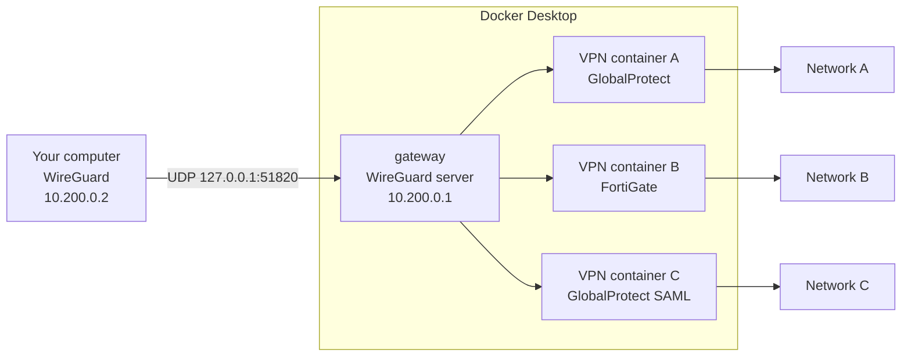
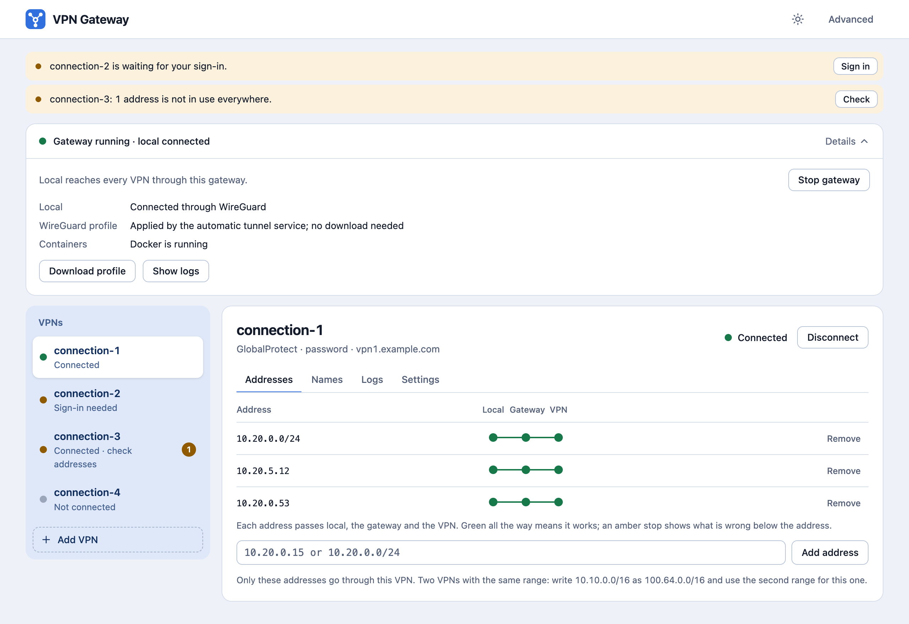

# VPN Gateway documentation

Everything about VPN Gateway: how to install and use it, what it changes on your computer, the command line, the
configuration file, and how it works inside. The [README](../README.md) is the short introduction.



- One JSON file (`data/systems.json`) lists every VPN. The web page writes it; you can also edit it by hand.
- Each VPN runs in its own Docker container. A WireGuard gateway container sits in front of them. Your computer
  makes one WireGuard connection to the gateway, and the gateway sends each packet into the right VPN.
- There is a local web page (`./vpn web`) and a command line tool (`./vpn`). Both do the same work.

## Contents

**Part 1: Use it**

- [Before you start](#before-you-start)
- [Supported VPNs](#supported-vpns)
- [What you need](#what-you-need)
- [Setup on a Mac](#setup-on-a-mac)
- [Setup on Windows](#setup-on-windows)
- [What to fill in](#what-to-fill-in)
- [Every day](#every-day)
- [Reaching servers by name](#reaching-servers-by-name)
- [Things to keep in mind](#things-to-keep-in-mind)
- [System files VPN Gateway changes](#system-files-vpn-gateway-changes)
- [Stop or remove](#stop-or-remove)
- [Update](#update)

**Part 2: Reference**

- [Web page](#web-page)
- [Configure your VPNs (systems.json)](#configure-your-vpns-systemsjson)
- [First start (command line)](#first-start-command-line)
- [Log in to each VPN (command line)](#log-in-to-each-vpn-command-line)
- [Everyday commands](#everyday-commands)
- [Sign-in helper (Mac)](#sign-in-helper-mac)
- [Automatic tunnel (Mac)](#automatic-tunnel-mac)
- [Windows specifics](#windows-specifics)
- [How it works](#how-it-works)
- [Troubleshooting](#troubleshooting)
- [Security notes](#security-notes)
- [Known limits](#known-limits)
- [Development](#development)

---

# Part 1: Use it

## Before you start

> [!IMPORTANT]
> Use VPN Gateway only for networks you are allowed to use. Check each organization's rules first:
>
> - Some organizations allow no VPN app other than their own.
> - Some require a managed device or a device health check (GlobalProtect HIP); VPN Gateway does not send one.
> - Some contracts forbid being connected to other networks at the same time.
>
> If you are not sure, ask their IT team.

## Supported VPNs

| `method`      | VPN                         | Login                                              | Client in the container |
|---------------|-----------------------------|----------------------------------------------------|-------------------------|
| `gp-password` | Palo Alto GlobalProtect     | user name and password (asked at every connect), plus MFA | openconnect             |
| `gp-saml`     | Palo Alto GlobalProtect     | SAML single sign-on in your browser                | openconnect             |
| `forti-saml`  | Fortinet FortiGate SSL VPN  | SAML single sign-on in your browser                | openfortivpn            |

## What you need

A few free programs. Install them once.

| | Mac | Windows |
|---|---|---|
| **Docker Desktop** runs each VPN in the background | <https://www.docker.com/products/docker-desktop/> | <https://www.docker.com/products/docker-desktop/> |
| **WireGuard** connects your computer to VPN Gateway | [Mac App Store](https://apps.apple.com/app/wireguard/id1451685025) | <https://www.wireguard.com/install/> |
| **Git** downloads VPN Gateway | Comes with the Mac developer tools (see below) | <https://git-scm.com/download/win> |
| **Python** runs VPN Gateway | Comes with the Mac developer tools | <https://www.python.org/downloads/windows/> |

After installing Docker Desktop, open it once and wait until it says it is running.

More about the requirements:

- macOS on Apple silicon or Intel, or Windows 10/11. The containers are Linux, so the gateway itself also runs on
  Linux.
- Docker Desktop must include `docker compose` (Docker Engine 28 or later, Compose 2.33 or later: the compose file
  uses `gw_priority`) and must be running while you use VPN Gateway. On Windows it uses the **WSL 2** backend
  (the default).
- Python 3.9 or later. VPN Gateway uses only the standard library, so there is nothing to `pip install`.
- Only for the [sign-in helper on a Mac](#sign-in-helper-mac): the Xcode Command Line Tools
  (`xcode-select --install`).

## Setup on a Mac

```mermaid
flowchart TD
    start(["Start"]) --> docker["Install Docker Desktop<br/>open it once, wait until it is running"]
    docker --> wg["Install WireGuard<br/>from the Mac App Store"]
    wg --> git{"git --version<br/>works in Terminal?"}
    git -->|"No"| clt["Accept the developer tools install<br/>it also installs Python 3"]
    git -->|"Yes"| clone
    clt --> clone["git clone https://github.com/tariktekin8/vpn-gateway.git<br/>cd vpn-gateway"]
    clone --> web["./vpn web<br/>creates data/, the WireGuard keys and the compose file<br/>prints a one-time link and opens it"]
    web --> gw["Page: Start the gateway<br/>first time: builds the gateway image, a few minutes"]
    gw --> tunnel{"How should the<br/>tunnel run?"}
    tunnel -->|"Automatic tunnel (recommended)"| brew["brew install wireguard-tools<br/>sudo handlers/macos/install-tunnel.sh"]
    brew --> off["Turn off every vpn-gateway tunnel<br/>in the WireGuard app"]
    tunnel -->|"WireGuard app"| import["Page: Download profile<br/>WireGuard app: Import tunnel(s) from file, Activate"]
    off --> add
    import --> add["Page: Add VPN<br/>name, method, host, subnets"]
    add --> pinq{"Automatic tunnel?"}
    pinq -->|"Yes"| pin["sudo handlers/macos/install-tunnel.sh again<br/>allows the new addresses"]
    pinq -->|"No"| method
    pin --> method{"Method"}
    method -->|"gp-saml"| helper["Optional, once: handlers/macos/install.sh<br/>the sign-in helper catches the callback link"]
    method -->|"gp-password or forti-saml"| connect
    helper --> connect["Page: Connect<br/>first time: builds the VPN image"]
    connect --> login{"Sign in"}
    login -->|"gp-password"| pass["Type the password<br/>approve MFA or type the code"]
    login -->|"gp-saml or forti-saml"| sso["Sign in on the pop-up page"]
    pass --> green
    sso --> green["Green dot: connected<br/>Addresses tab: three green stops"]
    green --> names{"Reach servers<br/>by name?"}
    names -->|"No"| done(["Done"])
    names -->|"Yes"| allow["Names tab: Use next to each domain<br/>Add to Addresses next to the DNS server"]
    allow --> auto{"Automatic tunnel?"}
    auto -->|"Yes"| pin2["sudo handlers/macos/install-tunnel.sh again<br/>allows the new domains"]
    pin2 --> resolver["/etc/resolver files are written<br/>within 5 seconds"]
    auto -->|"No"| byhand["Write /etc/resolver/DOMAIN by hand"]
    resolver --> done
    byhand --> done
```



Open the **Terminal** app (press Cmd-Space, type "Terminal", press Enter). Copy each command, paste it into
Terminal and press Enter.

### 1. Install the tools

1. Install **Docker Desktop** from <https://www.docker.com/products/docker-desktop/>. Open it once and wait until
   it says it is running.
2. Install **WireGuard** from the [Mac App Store](https://apps.apple.com/app/wireguard/id1451685025).
3. Type `git --version`. If the Mac offers to install the developer tools, accept and wait. This also installs
   Python 3.

### 2. Download and start VPN Gateway

```sh
git clone https://github.com/tariktekin8/vpn-gateway.git
cd vpn-gateway
./vpn web
```

`./vpn web` creates the `data/` folder, the WireGuard keys and the compose file, prints the page's link
(`http://127.0.0.1:8765/#token=...`) and opens it in your browser. The link holds the page's key and changes at
every start. Keep Terminal open while you use the page; Ctrl-C stops the page, and your VPN connections keep running.

### 3. Start the gateway and connect the tunnel

1. On the page, press **Start the gateway**. The first time builds the gateway image and takes a few minutes.
2. Connect your computer to the gateway in one of two ways. Use only one of them: two clients with the same key
   break each other.
   - **Automatic tunnel (recommended).** A system service runs the tunnel and writes the DNS files for your VPNs.
     It accepts only the addresses and domains that existed when you last ran the installer, so run it again after
     you add a VPN, an address outside its ranges or a domain. It needs [Homebrew](https://brew.sh):

     ```sh
     brew install wireguard-tools
     sudo handlers/macos/install-tunnel.sh
     ```

     Then turn off every `vpn-gateway` tunnel in the WireGuard app. See [Automatic tunnel (Mac)](#automatic-tunnel-mac).
   - **WireGuard app.** Press **Download profile** (under **Advanced** or in the gateway's **Details**). In the
     WireGuard app, choose **Import tunnel(s) from file**, pick `vpn-gateway.conf` and activate it. Import it again
     whenever the page says **Your WireGuard profile changed**.

### 4. Add and connect your VPNs

1. Press **Add VPN** and fill in the form: [What to fill in](#what-to-fill-in).
2. For `gp-saml` VPNs, install the [sign-in helper (Mac)](#sign-in-helper-mac) once, so the login finishes by itself.
3. With the automatic tunnel, run `sudo handlers/macos/install-tunnel.sh` again: it allows the new addresses.
4. Press **Connect**. The first connect of each method builds its VPN image. Then sign in: see [Every day](#every-day).

### 5. Reach servers by name (optional)

Open the VPN's **Names** tab, press **Use** next to each of the organization's domains and **Add to Addresses**
next to its DNS server. With the automatic tunnel, run `sudo handlers/macos/install-tunnel.sh` again to allow the
new domains; names then work by themselves. Without it, write the resolver files by hand. See [Reaching servers by name](#reaching-servers-by-name).

**Next time**, only start the page:

```sh
cd vpn-gateway
./vpn web
```

## Setup on Windows

```mermaid
flowchart TD
    start(["Start"]) --> docker["Install Docker Desktop<br/>keep WSL 2, restart if asked, open it once"]
    docker --> wg["Install WireGuard for Windows"]
    wg --> py["Install Python<br/>tick Add python.exe to PATH"]
    py --> git["Install Git for Windows<br/>default options"]
    git --> clone["PowerShell: cd $HOME<br/>git clone https://github.com/tariktekin8/vpn-gateway.git<br/>cd vpn-gateway"]
    clone --> web[".\vpn.cmd web<br/>creates data\, the WireGuard keys and the compose file<br/>prints a one-time link and opens it"]
    web --> gw["Page: Start the gateway<br/>first time: builds the gateway image, a few minutes"]
    gw --> import["Page: Download profile<br/>WireGuard: Import tunnel(s) from file, Activate"]
    import --> add["Page: Add VPN<br/>name, method, host, subnets"]
    add --> method{"Method"}
    method -->|"gp-saml"| helper["Optional, once: handlers\windows\install.ps1<br/>the sign-in helper catches the callback link"]
    method -->|"gp-password or forti-saml"| connect
    helper --> connect["Page: Connect<br/>first time: builds the VPN image"]
    connect --> login{"Sign in"}
    login -->|"gp-password"| pass["Type the password<br/>approve MFA or type the code"]
    login -->|"gp-saml or forti-saml"| sso["Sign in on the pop-up page"]
    pass --> green
    sso --> green["Green dot: connected<br/>Addresses tab: three green stops"]
    green --> names{"Reach servers<br/>by name?"}
    names -->|"No"| done(["Done"])
    names -->|"Yes"| allow["Names tab: Add to Addresses<br/>next to the DNS server"]
    allow --> nrpt["PowerShell as administrator:<br/>Add-DnsClientNrptRule for each domain"]
    nrpt --> done
    done -.->|"Later you change addresses"| again["Page says Your WireGuard profile changed:<br/>Download profile, import it again"]
```



### 1. Install the tools

1. **Docker Desktop** from <https://www.docker.com/products/docker-desktop/>: keep the default **WSL 2** option.
   Restart the PC if it asks. Open Docker Desktop once and wait until it is running.
2. **WireGuard for Windows** from <https://www.wireguard.com/install/>.
3. **Python** from <https://www.python.org/downloads/windows/>: on the first screen, tick **Add python.exe to PATH**
   and keep **py launcher** selected.
4. **Git for Windows** from <https://git-scm.com/download/win>: the default options are fine. The repository's
   `.gitattributes` keeps the container scripts in Unix line endings, so they run.

### 2. Download and start VPN Gateway

Open **PowerShell** (press the Windows key, type "PowerShell", press Enter). Paste each line (right-click pastes)
and press Enter:

```powershell
cd $HOME
git clone https://github.com/tariktekin8/vpn-gateway.git
cd vpn-gateway
.\vpn.cmd web
```

The folder must stay inside your user folder (`C:\Users\<you>\vpn-gateway`): Windows keeps it private to you there.
Do not move it to a shared folder. The page opens in your browser; if it does not, open the link the command
printed. Keep PowerShell open while you use the page; Ctrl-C stops it.

### 3. Start the gateway and connect the tunnel

1. On the page, press **Start the gateway**. The first time takes a few minutes.
2. Press **Download profile** (under **Advanced** or in the gateway's **Details**). In WireGuard, choose
   **Import tunnel(s) from file**, pick `vpn-gateway.conf` and activate it.
3. Import it again whenever the page says **Your WireGuard profile changed** (after you change a VPN's addresses).

### 4. Add and connect your VPNs

1. Press **Add VPN** and fill in the form: [What to fill in](#what-to-fill-in).
2. For `gp-saml` VPNs, install the [sign-in helper (Windows)](#sign-in-helper-windows) once.
3. Press **Connect** and sign in: see [Every day](#every-day).

### 5. Reach servers by name (optional)

Press **Add to Addresses** next to the VPN's DNS server in its **Names** tab, then add an NRPT rule for each domain
as administrator. See [Reaching servers by name](#reaching-servers-by-name).

**Next time**, open PowerShell and run:

```powershell
cd $HOME\vpn-gateway
.\vpn.cmd web
```

## What to fill in

Ask the IT team that gave you the VPN, or look at the settings of the VPN app they gave you. VPN Gateway writes your
answers to `data/systems.json`; nothing else needs to be configured by hand.

| Field | What to write |
|---|---|
| **Name** | A short name for yourself, for example `connection-1`. Starts with a small letter; then small letters, numbers and `-`; at most 31 characters. `gateway` is taken. |
| **Method** | `gp-password`: GlobalProtect with a user name and password. `gp-saml`: GlobalProtect that opens a sign-in page. `forti-saml`: FortiGate (FortiClient) that opens a sign-in page. |
| **Host** | The VPN address, for example `vpn1.example.com`: a host name or IPv4 address, nothing else. Add `:port` if they gave you a port, for example `vpn3.example.com:10443`. |
| **User** | Your VPN user name (only for `gp-password`). |
| **Subnets** | The addresses you want to reach through this VPN, one per line, for example `10.20.0.15`. **Only these go through the VPN; nothing else does.** Add the VPN's DNS server too if you want to use names. To allow only some ports, add them at the end: `10.20.0.15 ports 443,3389`. If two VPNs use the same addresses, write `10.10.0.0/16 as 100.64.0.0/16` for one of them and use the second range to reach it. IPv4 only, at most a `/8`. |
| **Disconnect when idle** | Optional. Minutes without traffic from your computer after which the VPN disconnects, for example `120`. Empty: it stays connected. |

## Every day

1. Make sure Docker Desktop is running.
2. Start the page (`./vpn web` in Terminal, `.\vpn.cmd web` in PowerShell). It opens in your browser; if it
   does not, open the link the command printed.
3. The page shows your VPNs in a list on the left. Pick one and press **Connect**, then log in:
   - **Password VPNs:** type your password in the box that opens and press **Connect**. VPN Gateway asks for it
     every time and never stores it. Approve the sign-in on your phone if the VPN asks, or type the code in the
     **Code** box.
   - **Sign-in page VPNs:** a small window opens with the VPN's sign-in page. Sign in as usual. The window
     closes by itself when you are connected.
     For GlobalProtect sign-in pages (`gp-saml`), install a small helper once so this works by itself:
     on a Mac, the [sign-in helper (Mac)](#sign-in-helper-mac); on Windows, the
     [sign-in helper (Windows)](#sign-in-helper-windows). When the helper hands the sign-in over, the VPN's page
     asks `Connect as <user>?`: press **Connect** only if that is the account you just signed in with. Without the
     helper, the VPN's page shows you how to copy a link by hand.
4. A green dot means connected. Anything that needs you (a sign-in, an error, an address that does not work) shows
   in a strip at the top of the page, with a button that takes you there.

To see or change the addresses a VPN reaches, open its **Addresses** tab. Each address shows three stops, which
must all be green: **local** sends it into the tunnel, the **gateway** sends it to the right VPN, and the
**VPN** passes it on. Add or remove an address there; it applies at once, also to a connected VPN.

VPN sessions end after some hours, as the organization sets them. When a VPN's dot is no longer green, press
**Connect** again.

Without the automatic tunnel, the top strip says **Your WireGuard profile changed** after you change a VPN's
addresses. Press **Download profile** and import it again in WireGuard (it asks to replace the old one). On a Mac
the [automatic tunnel](#automatic-tunnel-mac) does this for you.

## Reaching servers by name

Every address you list in a VPN's **Subnets** works by its number, for example `10.20.0.15`. To use names such as
`server.corp1.example.com`, the VPN's **DNS server** must be in its Subnets too, and you must allow the domain. The
VPN's **Names** tab shows the domains and DNS servers the VPN sent: press **Use** next to a domain to allow it, and
**Add to Addresses** next to a DNS server. Allow only the organization's own domains. A VPN cannot make your
computer look up any other name through it, for example a public website's or another organization's.

**Mac with the [automatic tunnel](#automatic-tunnel-mac):** after you allow a domain, run
`sudo handlers/macos/install-tunnel.sh` again; the service uses only the domains that existed when it last ran.
Then names work by themselves. When the VPN connects, VPN Gateway writes `/etc/resolver/<domain>` for each allowed domain within 5 seconds, with
the DNS servers the VPN sent that are inside its own Subnets. While the VPN is off, the file points at the gateway
(`10.200.0.1`), which answers every name with "no such name": the lookup fails at once and the internal name never
goes to your normal DNS. The file is deleted when you stop allowing the domain or delete the VPN. It only touches files whose first line is `# managed by vpn-gateway`, so a file you wrote yourself
stays as it is: delete your own file if you want VPN Gateway to take over that domain. Every domain and address is
checked first: the domain needs at least one dot (never a whole top-level domain) and only letters, digits, `-` and
dots; the servers must be IPv4 addresses.

**Mac without the automatic tunnel:** create one file per domain, once (it asks for your Mac password):

```sh
sudo mkdir -p /etc/resolver
echo "nameserver 10.20.0.53" | sudo tee /etc/resolver/corp1.example.com
```

Replace `10.20.0.53` with the DNS server and `corp1.example.com` with the domain. Check it with
`scutil --dns | grep -A3 corp1.example.com`. Remove it with `sudo rm /etc/resolver/corp1.example.com`.

**Windows:** add a Name Resolution Policy Table (NRPT) rule, once. Open PowerShell **as administrator**
(right-click PowerShell, **Run as administrator**) and run:

```powershell
Add-DnsClientNrptRule -Namespace ".corp1.example.com" -NameServers "10.20.0.53"
Get-DnsClientNrptRule                                   # list the rules
Get-DnsClientNrptRule | Where-Object Namespace -eq ".corp1.example.com" | Remove-DnsClientNrptRule -Force
```

On a Mac, names that end in `.local` go to Bonjour (mDNS) first. Reach those servers by their address.

## Things to keep in mind

- Keep Terminal (PowerShell on Windows) open with `vpn web` running while you use the page.
- Docker Desktop must be running.
- The tunnel must be on: in the WireGuard app (turn it off and on to refresh it), or the automatic tunnel on a Mac.
- Allow pop-ups for the page: sign-in windows open as pop-ups.
- Ports 51820 (UDP) and 8020 (TCP) on `127.0.0.1` must be free: quit the official FortiClient and other WireGuard
  tunnels first.
- Sign in to one FortiGate VPN at a time: FortiGate sign-ins share port 8020.
- Test an address with the program you need (browser, SAP, remote desktop). Many networks block ping.
- A VPN's **Logs** tab shows what it is doing. Check log lines for user names and addresses before you share them.

## System files VPN Gateway changes

The normal setup writes only inside the `vpn-gateway` folder and in Docker Desktop. It changes no system file.
System files change only when you install one of these optional parts, or set up DNS by hand:

### System files on a Mac

| Part | System files it writes | Removed by |
|---|---|---|
| Automatic tunnel (`sudo handlers/macos/install-tunnel.sh`, runs as root) | `/Library/LaunchDaemons/com.athenayazilim.vpn-gateway.tunnel.plist` (a background service)<br>`/Library/PrivilegedHelperTools/vpn-gateway/` (the service's script, its copies of `wg` and `wireguard-go`, and the pinned gateway key)<br>`/etc/wireguard/vpn-gateway.conf` (a copy of the WireGuard profile)<br>`/etc/resolver/<domain>` (one file per VPN domain, marked `# managed by vpn-gateway`)<br>`/var/log/vpn-gateway.log` (its log, readable by root only) | `sudo handlers/macos/uninstall-tunnel.sh` removes all but the log; delete the log with `sudo rm /var/log/vpn-gateway.log` |
| Sign-in helper (`handlers/macos/install.sh`) | `~/Applications/VPN Gateway Callback.app`, registered with macOS to open `globalprotectcallback:` links | `handlers/macos/uninstall.sh` |
| DNS by hand ([Reaching servers by name](#reaching-servers-by-name)) | The `/etc/resolver/<domain>` files you create | `sudo rm /etc/resolver/<domain>` |

The automatic tunnel also needs `wireguard-tools` from Homebrew (`brew install wireguard-tools`).

### System files on Windows

| Part | System files it writes | Removed by |
|---|---|---|
| Sign-in helper (`handlers\windows\install.ps1`) | Registry key `HKCU\Software\Classes\globalprotectcallback` (your user only) | `handlers\windows\uninstall.ps1` |
| DNS by hand ([Reaching servers by name](#reaching-servers-by-name)) | The NRPT rules you add | `Remove-DnsClientNrptRule` |

## Stop or remove

- To disconnect one VPN, press **Disconnect**. To stop everything, choose **Advanced**, **Stop all connections**.
- To remove VPN Gateway:
  1. Choose **Stop all connections**, and delete the `vpn-gateway` tunnel in the WireGuard app.
  2. Remove the optional parts you installed (see [System files](#system-files-vpn-gateway-changes)).
  3. Remove the Docker parts (Terminal or PowerShell):

     ```sh
     docker compose -p vpn-gateway down --volumes
     docker image rm vpn-gateway vpn-openconnect vpn-openfortivpn
     ```

  4. Delete the `vpn-gateway` folder. Its `data/` folder holds your settings and WireGuard keys; it is deleted with it.

## Update

When a new version is out, `./vpn web` prints a line about it and the page shows **A new version is out**. VPN
Gateway never updates itself: you choose when.

- To get an e-mail for each new version, open the [project on GitHub](https://github.com/tariktekin8/vpn-gateway),
  choose **Watch**, **Custom** and tick **Releases**.
- To update:
  1. Read the new version in the [changelog](../CHANGELOG.md). If it has an **Upgrading** part, follow it.
  2. Stop `./vpn web` with Ctrl-C.
  3. In the `vpn-gateway` folder, run `git pull`. Your `data/` folder is not changed.
  4. Start `./vpn web` again (`.\vpn.cmd web` on Windows).
  5. Disconnect and connect each VPN once. The new images are built then.
- To turn the check off, set the environment variable `VPN_GATEWAY_NO_UPDATE_CHECK=1` before `./vpn web`.

The check runs once at each start of `./vpn web`. It asks GitHub for the newest release of this project
(`api.github.com`) and compares it with the newest version tag in your folder. The request holds no data of yours;
GitHub sees your public IP address, as with any web page.

---

# Part 2: Reference

## Web page

```sh
./vpn web              # opens http://127.0.0.1:8765/#token=<key>
./vpn web --port 9000
```

The page has two panes: the list of VPNs on the left, each with its state, and the chosen VPN on the right, with a
Connect or Disconnect button, the login steps and four tabs: **Addresses**, **Names** (DNS), **Logs** and
**Settings** (edit or delete). A strip at the top lists what needs you (a login, an error, an address that does not
work, a changed profile). A bar above the VPNs always shows the gateway's state; open its **Details** for the
gateway's facts, Start/Stop, the profile download and **Show logs**. The profile download and **Stop all
connections** are also under **Advanced**. The theme button switches between System, Light and Dark. Ctrl-C stops
the server; the containers keep running.



- **Addresses** lists every address of the VPN and whether local (`route -n get` on a Mac, the best route on
  Windows), the gateway (`ip route` in the gateway container) and the VPN container (`/state/<name>/<name>.routes` in the gateway) use it.
  Adding or removing an address there, or changing subnets in **Settings**, saves `systems.json` and gives a
  connected VPN its new list at once: the page starts the container's `hub-link.sh` again with the new
  `VPN_SUBNETS` and stops the old one, so the VPN session stays up. The automatic tunnel applies the new profile
  within 5 seconds.
- **Names** lists the domains and DNS servers the VPN pushed, and whether each server is in Addresses.
- **Download profile** saves the gateway's profile as `vpn-gateway.conf`. The page remembers (in this browser
  only) which version you downloaded and says so in the top strip when the gateway writes a new one. The file holds
  a private key: do not share it.
- The server reads `data/systems.json` again on every request, so edits by hand or by the command line show up at
  once. If `data/systems.json` is broken, the page shows the error and refuses to save until you fix the file by
  hand.
- `forti-saml`: Connect opens a pop-up. When the container prints its "Authenticate at" address, the page loads it
  into the pop-up, but only an `https://` address on the VPN's own `host` and port; any other address is ignored. After the login FortiGate sends the browser to `http://127.0.0.1:8020/`; the gateway passes it to
  the FortiGate VPN whose login runs now, and the page closes the pop-up when the tunnel is up. The "Authenticate
  at" link stays on the VPN's page as the fallback. The page says when another FortiGate login holds the port.
- `gp-saml`: the login runs in a browser pop-up that the page opens. The server answers Connect with a
  `popup_url`: the IdP address (REDIRECT gateways) or a one-time `/saml/<nonce>` page that holds the gateway's
  auto-submitting login form (POST gateways). The login ends on a `globalprotectcallback:` link. The sign-in helper
  hands it to the server; without the helper, paste the link on the VPN's page.
- A pop-up blocker can stop the login pop-up; the page then offers a link. After a page reload, or on login sites
  that set `Cross-Origin-Opener-Policy`, close the login pop-up by hand.

## Configure your VPNs (`systems.json`)

The web page writes `data/systems.json` for you. To edit it by hand instead, copy the example and open it in an
editor:

```sh
mkdir -m 700 data
cp systems.example.json data/systems.json
chmod 600 data/systems.json
```

On Windows: `mkdir data`, `copy systems.example.json data\systems.json`, `notepad data\systems.json`.

`data/systems.json` holds a list of `systems`. Each system is one VPN:

```json
{
  "systems": [
    {
      "name": "connection-1",
      "method": "gp-password",
      "host": "vpn1.example.com",
      "user": "jdoe",
      "subnets": ["10.10.0.0/16"]
    },
    {
      "name": "connection-2",
      "method": "gp-saml",
      "host": "vpn2.example.com",
      "subnets": ["172.20.5.10", "172.20.5.11"]
    },
    {
      "name": "connection-3",
      "method": "forti-saml",
      "host": "vpn3.example.com:10443",
      "subnets": []
    }
  ]
}
```

| Field      | Needed for                 | Meaning |
|------------|----------------------------|---------|
| `name`     | all                        | Short id: a lower-case letter, then lower-case letters, digits and `-`; at most 31 characters. It names the container (`vpn-<name>`). `gateway` is reserved. |
| `method`   | all                        | One of the methods in [Supported VPNs](#supported-vpns). |
| `host`     | all                        | VPN address: a host name or IPv4 address, plus `:port` if it is not 443. No path, user name or other part. |
| `user`     | `gp-password`              | Your VPN user name. |
| `subnets`  | optional                   | What your computer sends into this VPN. See below. |
| `domains`  | optional                   | DNS domains looked up through this VPN, for example `["corp1.example.com"]` (lower case). The **Use** button in the Names tab adds them. A domain belongs to one VPN only, subdomains included. |
| `idle_minutes` | optional               | Disconnect after this many minutes (1 to 1440) without traffic from your computer into the tunnel. Traffic from the VPN side does not count. Not set: stay connected. |

**About `subnets`:**

- List what you need: networks (`10.10.0.0/16`) or single servers (`10.10.1.5`, saved as `/32`).
- **Only these addresses go through the VPN.** The routes the VPN server pushes are ignored, and a system with
  empty `subnets` (`[]`) reaches nothing. The gateway enforces this with a firewall allow-list, and a listed range
  whose VPN is not connected is dropped, never sent out through the normal internet.
- Nothing on the VPN side can open a connection to your computer; only replies come back.
- To use names, also list the VPN's DNS server (see [Reaching servers by name](#reaching-servers-by-name)).
- Two systems may not list overlapping subnets. `./vpn check` refuses that, and suggests the fix below.
- **Two VPNs with the same range:** write the entry as `"<real range> as <shown range>"` for one of them, for
  example `"10.10.0.0/16 as 100.64.0.0/16"`. Your computer then reaches that VPN's `10.10.x.y` at `100.64.x.y`:
  its container maps each address one to one (`iptables` NETMAP) and maps replies back. Both ranges must be IPv4
  and the same size. Pick a shown range no VPN uses; `100.64.0.0/10` (shared address space) is a good place. The
  shown range is what goes into the WireGuard profile and the overlap check. Names from that VPN's DNS resolve to
  the real addresses, so reach that VPN by the shown addresses. A DNS server inside a mapped real range is reached
  at its real address, which takes that one address away from the other VPN.
- **Only some ports:** end the entry with `ports` and up to 15 port numbers, for example `"10.20.0.15 ports 443,3389"`
  or `"10.10.0.0/16 as 100.64.0.0/16 ports 22"`. The gateway then forwards only TCP and UDP to those ports of that
  range (`data/wireguard/port-limits`); ping and other ports are dropped. Without `ports`, every port is allowed.
- IPv4 only, and at most a `/8`. Loopback (`127.0.0.0/8`), link-local (`169.254.0.0/16`), multicast, reserved
  and `0.0.0.0/8` ranges are refused: they must never go into a tunnel.
- `"TODO"` is accepted as a placeholder and ignored.
- If a range clashes with your home or office network (for example `192.168.0.0/16` against your Wi-Fi's
  `192.168.1.0/24`), list the narrower ranges you need.

**About passwords:** `data/systems.json` holds no password, cookie or token; VPN Gateway refuses one there. It asks
for a `gp-password` password at every connect and sends it straight into the VPN container (see
[Security notes](#security-notes)). Everything VPN Gateway writes lives in `data/`, which is git-ignored. Never
commit it.

Validate the file at any time:

```sh
./vpn check
```

## First start (command line)

1. Start the gateway and all VPN containers (with no systems yet, only the gateway starts):

   ```sh
   ./vpn up
   ```

   The first run builds the images and takes a few minutes. VPN Gateway regenerates
   `data/docker-compose.generated.json` from `data/systems.json` on every run, so you never edit the compose file.

2. Log in to each VPN (next section). A VPN shares its routes with the gateway only after it is connected.

3. Import the profile into WireGuard. The gateway writes it to `data/wireguard/mac.conf` (the same name on every
   system): open the WireGuard app, choose **Import tunnel(s) from file**, pick `data/wireguard/mac.conf`, then
   **Activate**. On a Mac, `open data/wireguard` shows the folder in Finder.

4. Check the state:

   ```sh
   ./vpn status
   ```

   ```text
   gateway       wireguard    running      Mac connected
   connection-1  gp-password  running      tun0 up, 1 routes to Mac
   connection-2  gp-saml      running      tun0 up, 2 routes to Mac
   connection-3  forti-saml   running      ppp0 up, 3 routes to Mac
   ```

   "Mac" in this output means your computer, on Windows too.

> **Import the WireGuard profile again when it changes.** The profile always holds every `subnets` entry from
> `data/systems.json` and nothing else, so it changes only when you edit `subnets`, never when a VPN connects or
> disconnects. The WireGuard app does not reload the file by itself. While a VPN is off, its addresses still
> enter the tunnel and are dropped at the gateway. The web page's top strip tells you when this is needed; in the
> terminal, the gateway log shows the new list: `docker logs vpn-gateway | tail -1`. The
> [automatic tunnel](#automatic-tunnel-mac) does this for you on a Mac.

## Log in to each VPN (command line)

```sh
./vpn login <name>
```

This starts the gateway and that one VPN container, then walks you through the login. When the tunnel is up you
can press Ctrl-C: that only stops following the log, the tunnel stays up.

### `gp-password`

- VPN Gateway asks for the password (the input is hidden) and sends it into the container. Approve the MFA push on
  your phone if asked.
- If the log asks for a code, run `./vpn type <name>` in a second terminal and type it.

### `gp-saml`

1. VPN Gateway opens the SAML login page of the gateway in your default browser.
2. **Before you log in**, open the browser's developer tools (Cmd-Opt-I on a Mac, F12 on Windows) on the Console
   tab.
3. Log in as usual (company SSO, MFA).
4. At the end the page tries to open a link that starts with `globalprotectcallback:`. Copy that whole link from
   the Console error or the browser's prompt.
5. Paste it into the terminal and press Enter. The input is hidden on purpose: the link holds a session cookie.
   Never paste it into a chat or a ticket.

The web page with the sign-in helper ([Mac](#sign-in-helper-mac), [Windows](#sign-in-helper-windows)) catches the
link for you, so you skip steps 2, 4 and 5. The command line always asks you to paste it.

### `forti-saml`

1. The container prints an `Authenticate at` address. Open it in your browser.
2. Log in as usual. At the end FortiGate sends the browser to `http://127.0.0.1:8020/`. The gateway serves that port
   and passes it to the FortiGate system whose login runs now, so several `forti-saml` systems work, one login at
   a time: the last one started gets the port. VPN Gateway on your computer picks it, never a VPN container.
   The gateway connects a browser connection to the VPN only once its request arrives: browsers open spare
   connections ahead of time, and openfortivpn serves one connection at a time, so an idle spare would hold the
   sign-in back for about a minute. A connection that sends nothing for 60 seconds is closed.
  Nothing to copy.

## Everyday commands

```sh
./vpn check            # validate data/systems.json and regenerate the compose file
./vpn up [name...]     # start containers (all if no name) and the gateway; a gp-password one waits for login
./vpn login <name>     # start one system and log in
./vpn type <name>      # send a code (MFA) to a system that asks for one
./vpn status           # container, tunnel and route state per system
./vpn down [name...]   # stop containers (all if no name)
./vpn rotate-keys      # stop everything and make new WireGuard keys at the next gateway start
docker logs -f vpn-<name>   # follow one VPN's log
```

On Windows, use `.\vpn.cmd` in place of `./vpn`; it works in Command Prompt and PowerShell.

When a VPN session ends (the organization sets how long it lasts), run `./vpn login <name>` again.

## Sign-in helper (Mac)

`VPN Gateway Callback` is a tiny Mac app that receives `globalprotectcallback:` links and forwards them to the
running `./vpn web` (`POST /handler/callback` on 127.0.0.1). It shows nothing when it works and an alert when it
fails. It is one Swift file (`handlers/macos/CallbackHandler.swift`), built on your Mac with the Xcode Command Line
Tools.

```sh
xcode-select --install                   # once, if you do not have the Command Line Tools
handlers/macos/install.sh                # build, sign ad hoc, register ~/Applications/VPN Gateway Callback.app
handlers/macos/install.sh --take-over    # the same, and make it the default even when GlobalProtect is installed
handlers/macos/uninstall.sh              # unregister and delete it
```

- The first time a login hands over a link, the browser asks "Open VPN Gateway Callback?". Allow it. The VPN's
  page then asks `Connect as <user>?`; press **Connect** if that is your account.
- If the official GlobalProtect app is installed, it owns `globalprotectcallback:` links. `install.sh` then
  installs VPN Gateway Callback without making it the default, unless you pass `--take-over`.
  **Taking over breaks the official app's browser login** until you run `handlers/macos/uninstall.sh`.
- The app stores the absolute path of this folder's `data/secrets/web-handler.json`. Run
  `handlers/macos/install.sh` again if you move the folder.
- If the folder is under Documents, Desktop or Downloads, macOS asks whether VPN Gateway Callback may access it.
  Allow it, so it can read the handler file.
- Some Command Line Tools releases fail with `redefinition of module 'SwiftBridging'`. `install.sh` works around
  this with a compiler overlay; it does not change system files.
- `./vpn web` must be running when the link arrives. When two `gp-saml` logins wait at once, the helper refuses (it
  never guesses): paste the link on the right VPN's page. Only the last started `./vpn web` owns
  `data/secrets/web-handler.json`; the helper talks to that one. If the web server restarts during a login, start
  the login again.

## Automatic tunnel (Mac)

Instead of importing the profile in the WireGuard app, VPN Gateway can run the tunnel itself as a system service.
It brings the tunnel up at boot and applies a new profile within 5 seconds of the gateway writing it, so you never
download or import again. It also sets up names for the VPNs (see
[Reaching servers by name](#reaching-servers-by-name)).

The installer pins what the service may use: the gateway's key, the address ranges in the profile and the DNS
domains, as they are when you run it. Removing addresses, and addresses inside a pinned range, apply by themselves.
**After you add a VPN, an address outside the pinned ranges or a domain, run the installer again**; until then the
new address does not go into the tunnel (the Addresses tab shows its **local** stop as not green) and the log says
which ones wait.

```sh
brew install wireguard-tools                 # as your user: wg and wireguard-go
sudo handlers/macos/install-tunnel.sh        # once; asks for your password
sudo handlers/macos/uninstall-tunnel.sh      # remove it
```

- Then turn off (or delete) the vpn-gateway tunnel in the WireGuard app, and do not import the profile there again.
  Two clients with the same key fight each other and nothing gets through. If it happens anyway, the service
  notices within 5 seconds that the gateway address left its tunnel and sets the tunnel up again.
- The service is a launchd daemon (`com.athenayazilim.vpn-gateway.tunnel`) that runs
  `/Library/PrivilegedHelperTools/vpn-gateway/tunnel-service` as root. Its log is `/var/log/vpn-gateway.log`. The gateway bar on the
  web page says when it is active (open its **Details**).
- It writes and removes `/etc/resolver/<domain>` files for the allowed domains of each VPN; `uninstall-tunnel.sh`
  removes the ones it wrote.
- The tunnel is called `vpn-gateway` (`sudo wg show` lists it under its `utun` name). Its config is a cleaned copy
  at `/etc/wireguard/vpn-gateway.conf`.
- Security: the service runs as root, and its inputs (the profile and the DNS file) sit in a folder your user can
  write. So:
  - Root runs nothing from a folder your user can write. The installer copies `wg` and `wireguard-go` into
    `/Library/PrivilegedHelperTools/vpn-gateway/` (owned by root), and the service's `PATH` holds only system
    folders. It does not use `wg-quick`, which needs a newer bash than macOS has.
  - Your user can read the gateway's private key and run Docker, so a program running as you could start a
    WireGuard server of its own with that key. The service therefore trusts only what the installer pinned in
    `/Library/PrivilegedHelperTools/vpn-gateway/` (owned by root): the gateway's public key (`peer`), the address
    ranges (`allowed`) and the domains (`domains`). The endpoint must be `127.0.0.1:51820` and the address
    `10.200.0.2/32`, or the tunnel is not brought up. An `AllowedIPs` entry is used only if it lies inside a pinned
    range. So such a program can reach at most the addresses you allowed, never the rest of your traffic.
  - A resolver file is written only for a pinned domain, and gets only DNS servers inside the tunnel (the gateway or
    an address in the applied `AllowedIPs`), never a server on the internet or your local network.
  - It reads the profile and the DNS file only if they are regular files owned by you, never through a link. Its log
    shows only checked values and only root can read it.
  - A program running as you that runs its own WireGuard server with the gateway's key could answer the pinned
    domains and take the traffic to the pinned addresses. It cannot reach any other name or address.
- Before it changes anything, the installer lists what the service will trust: the gateway's public key, every
  address range, every domain, and the path and SHA-256 of the `wg` and `wireguard-go` it copies. Lines marked `+`
  are new since the last install, `-` go away. It asks `Install with these? [y/N]` on the terminal; anything but
  yes changes nothing. `--yes` skips the question. Check the `+` lines: a program running as you could have added
  a range or a domain to `data/wireguard/` before you ran it.
- Run `install-tunnel.sh` again if you move the project folder (the service holds the path of
  `data/wireguard/mac.conf`), after `brew upgrade` updates `wireguard-tools` or `wireguard-go` (the service runs
  its own copies), and after the gateway gets new keys (the log then says "profile refused").
- The installer trusts what it finds when you run it: the `wg` and `wireguard-go` files in Homebrew's folders, and
  the gateway key, the addresses and the domains in `data/wireguard/`, which it shows you. Run it right after
  `brew install` and after **Start the gateway**, not after you ran programs you do not trust. `sudo` keeps your
  `PATH`, so the installer itself runs only system programs.
- To make new WireGuard keys, run `./vpn rotate-keys`. It stops every VPN and the gateway and deletes the keys and
  the profile. Then start the gateway, and import the new profile in the WireGuard app or run `install-tunnel.sh`
  again.

## Windows specifics

Everything else works the same way on Windows.

- Commands: `.\vpn.cmd` in place of `./vpn`.
- Names: NRPT rules instead of `/etc/resolver` (see [Reaching servers by name](#reaching-servers-by-name)).
- Files: Windows has no `chmod 600`. VPN Gateway creates `data\secrets` and `data\wireguard` with `icacls`: they
  stop inheriting the parent folder's permissions and allow only your user (full control). It prints a warning if
  `icacls` fails. Keep the project in your user folder. If Docker Desktop cannot read `data\wireguard` afterwards,
  report it.

### Sign-in helper (Windows)

`handlers\windows\callback.pyw` does what the Mac app does: Windows starts it for `globalprotectcallback:` links,
and it forwards them to the running `vpn web`. It is plain Python, so there is nothing to build. It is registered
for your Windows user only (under `HKEY_CURRENT_USER`), with no administrator rights.

```powershell
powershell -ExecutionPolicy Bypass -File handlers\windows\install.ps1              # register it
powershell -ExecutionPolicy Bypass -File handlers\windows\install.ps1 -TakeOver    # also when GlobalProtect is installed
powershell -ExecutionPolicy Bypass -File handlers\windows\uninstall.ps1            # remove it
```

- If the official GlobalProtect app is installed, `install.ps1` changes nothing unless you pass `-TakeOver`.
  **Taking over breaks the official app's browser login** until you run `handlers\windows\uninstall.ps1`.
- The registry entry holds the absolute path of the script. Run `install.ps1` again if you move the folder.
- The first time a login hands over a link, the browser asks whether to open it. Allow it. The VPN's page then asks
  `Connect as <user>?`; press **Connect** if that is your account.

## How it works

1. `./vpn` reads `data/systems.json`, checks it and writes
   `data/docker-compose.generated.json`: one service per system plus the `gateway` service.
2. Each VPN container runs its client (openconnect or openfortivpn) with `NET_ADMIN` and `/dev/net/tun`.
   A helper script (`docker/common/hub-link.sh`) adds NAT on the tunnel interface and writes the routes it serves
   to its own volume (`state-<name>`), `/state/<name>.routes`, every 5 seconds: the `subnets` from `data/systems.json` (the shown
   side of an `as` mapping), never the routes the VPN pushed. Its firewall drops connections opened from the VPN
   side. It also publishes the DNS the VPN pushed to `/state/<name>.dns` (openconnect: from the `resolv.conf`
   vpnc-script writes in the container; openfortivpn: from its "Got addresses … ns […], ns_suffix […]" log line).
3. The gateway (`docker/gateway/entrypoint.sh`) runs WireGuard on `10.200.0.1/24` and publishes UDP 51820 on
   `127.0.0.1` only. It mounts each VPN's volume read-only at `/state/<name>/`. Every 5 seconds it reads them,
   routes each network to the VPN it belongs to in `systems.json` (`data/wireguard/route-owners`), and rewrites `data/wireguard/mac.conf`. Its `AllowedIPs` hold the `subnets` from `systems.json` (VPN Gateway
   writes them to `data/wireguard/static-routes`) and nothing else. The same list is the gateway's firewall
   allow-list; a listed range without a connected VPN gets an `unreachable` route, so it never leaks out through
   Docker's network. It writes `data/wireguard/dns` ("domain server…" lines): for each connected VPN, the domains
   allowed for it (`data/wireguard/dns-owners`, from `domains`) with the DNS servers it sent that are inside its own
   `subnets`.
4. On your computer, WireGuard sends only those networks into the tunnel. Everything else uses your normal
   connection.

```text
.
├── vpn                        launcher: ./vpn <command>, ./vpn web (vpn.cmd on Windows)
├── src/
│   ├── cli.py                 command line (Python, standard library only)
│   └── server.py              web page server and API, reuses the command line's code
├── web/                       web page: index.html, style.css, app.js (built from web/src/app.ts)
├── package.json, tsconfig.json  TypeScript build for the web page only
├── docker/
│   ├── gateway/               WireGuard gateway image (dnsmasq, saml-forward.sh for the FortiGate port)
│   ├── openconnect/           GlobalProtect client image
│   ├── openfortivpn/          FortiGate client image
│   └── common/                hub-link.sh shares a tunnel's routes and DNS with the gateway;
│                              hide-cookies.sh hides login cookies in the logs
├── handlers/
│   ├── macos/                 sign-in helper for macOS (Swift), automatic tunnel, install scripts
│   └── windows/               sign-in helper for Windows (Python) and its install scripts
├── systems.example.json       example config; copy to data/systems.json
└── data/                      created by VPN Gateway (or you); git-ignored
    ├── systems.json           your VPNs (no passwords)
    ├── docker-compose.generated.json
    ├── secrets/               web-handler.json while vpn web runs; the portal's login form during ./vpn login
    ├── gateway/               written by this computer, read-only in the gateway (/config): static-routes,
    │                          route-owners, dns-owners, port-limits, saml-target
    └── wireguard/             written by the gateway (/keys): server.key, mac.key, mac.conf, dns
```

## Troubleshooting

**`./vpn status` says "no routes to Mac".** The VPN is not logged in yet. Run `./vpn login <name>`.

**Mac: addresses work only now and then, and `/var/log/vpn-gateway.log` shows "tunnel up" every 5 seconds.** A
tunnel for VPN Gateway is still on in the WireGuard app (each import adds one, "vpn-gateway (2)" and so on). The two
clients share one key and keep breaking each other. In the WireGuard app, turn off On-Demand for every vpn-gateway
tunnel, deactivate them, and delete them if you like: the automatic tunnel does not need them. `scutil --nc list`
shows which are connected.

**Mac, automatic tunnel: a new address or domain does not work.** The service uses only the addresses and domains
pinned when you last ran the installer. Run `sudo handlers/macos/install-tunnel.sh` again. `sudo tail
/var/log/vpn-gateway.log` shows what waits.

**Addresses work, but names of the organization do not.** A domain is used only after you allow it. Open the
VPN's **Names** tab and press **Use** next to each of the organization's domains.

**The tunnel is up, but your computer reaches nothing.**
1. Import `data/wireguard/mac.conf` (or the downloaded `vpn-gateway.conf`) in the WireGuard app again and activate
   it. This is the most common cause.
2. Check that your computer uses the tunnel for that address. Mac: `route -n get <ip>` shows a `utun` interface.
   Windows: `Find-NetRoute -RemoteIPAddress <ip>` shows the WireGuard interface.
3. Check that the gateway sends it to the right container: `docker exec vpn-gateway ip route get <ip>`.
4. Test a real port instead of ping, for example `nc -vz <ip> 443` on a Mac or
   `Test-NetConnection <ip> -Port 443` on Windows.

**Two VPNs use the same range (for example `10.0.0.0/8`).** The gateway sends a range to one container only.
List only the addresses you need in each system's `subnets`. If both really use the same addresses, reach one of
them under another range: `"10.10.0.0/16 as 100.64.0.0/16"` (see
[Configure your VPNs](#configure-your-vpns-systemsjson)).

**`gp-password` keeps asking for the password, or the log shows `512`.** The VPN refused the password. Disconnect,
then connect again and type it carefully. If it asks for a code, type it in the **Code** box (or
`./vpn type <name>`).

**`gp-saml` login fails with a "512" or asks for the cookie again.** SAML cookies work once. Run
`./vpn login <name>` again and paste the new link.

**Port 51820 or 8020 is already in use.** Another WireGuard tunnel or FortiClient uses it. Quit it, or stop the
other tunnel.

## Security notes

### What VPN Gateway gives you

- **Organizations stay apart.** Each VPN runs in its own container, on its own Docker network, with its own state
  volume. One organization's network cannot reach another's, even if a VPN client is taken over through a bug.
- **Nothing comes in.** No connection from an organization's network can reach your computer, the gateway or the
  VPN container itself. Only replies to your own connections pass.
- **Only what you list goes through a VPN.** Only the addresses (and `ports`, if you set them) you list for a VPN
  enter it. Your normal internet and your default DNS stay as they are.
- **No stored passwords or cookies.** Passwords are asked at every connect. Passwords, SAML cookies and MFA codes go
  to the VPN container through a pipe in memory and never reach a file, the environment or a log. Login cookies that
  the VPN clients print are hidden in the logs.
- **A private management page.** It listens on `127.0.0.1` only and needs the link that `./vpn web` prints. Other
  websites, other users on the network and other devices cannot use it.
- **Internal names stay with their organization** (Mac, automatic tunnel). Only domains you allowed go to that
  VPN's DNS servers, and only to servers inside its own subnets. While the VPN is off, those names get "no such
  name" from the gateway instead of going to your normal DNS.
- **Less exposure when you want it.** Port limits per address, and disconnect when idle.
- **Images you can review.** The images start from one fixed Debian image, and openfortivpn is built from one
  fixed commit.

### What VPN Gateway cannot give you

- **Protection for a compromised computer.** Your computer reaches every connected organization at once. Malware on
  it can reach them all, and can read the page link from the Terminal or the browser. See the advice at the end of
  this section.
- **Protection from unknown bugs** in Docker, WireGuard, openconnect or openfortivpn. The separate networks limit
  what such a bug can reach; they do not remove it.
- **A fully closed VPN container.** A VPN container needs the internet to reach its VPN server, and Docker Desktop
  lets every container reach the services on your computer's `127.0.0.1` (through `host.docker.internal`). A VPN
  container taken over through a bug in its VPN client could reach them: the web page (it still needs the page's
  link), the FortiGate sign-in port 8020, and any local service of yours, such as a development database. Keep
  local services behind a password, and stop VPNs you do not use.
- **A page link that expires while the page is open.** The link stops working after 12 hours without an API
  request, and when `./vpn web` stops. An open page asks for the status every few seconds, so it keeps its link
  alive as long as the tab is open. The link stays in the browser's history. Close the tab and stop `./vpn web`
  with Ctrl-C when you are done.
- **Unit tests on every change.** CI checks the web page build, Python syntax and the shell scripts
  (`.github/workflows/ci.yml`). The unit tests are not in the repository, so they run by hand, together with image
  builds, real logins and a leak scan.
- **Keys that change by themselves.** The WireGuard keys stay the same until you run `./vpn rotate-keys`.
- **Permission from the organization.** VPN Gateway does not check an organization's rules for you. Following them
  is your responsibility: see [Before you start](#before-you-start).
- **A device health report or a managed device.** VPN Gateway does not send a GlobalProtect HIP report and does not
  pretend to be a managed device. The organization may limit what you can reach, and it sees a Linux openconnect or
  openfortivpn client.
- **The organization's own filters for your internet traffic.** If an organization pushes a full tunnel, only
  traffic to its listed addresses goes to it. Your other internet traffic does not pass its filters, DLP or IDS. If
  the organization requires that, do not use VPN Gateway for it.
- **Clean logs to share.** The logs still hold host names, addresses and your user name. Check them before you share
  them.
- **Automatic DNS on Windows.** On Windows you add NRPT rules yourself, and nothing is automatic. VPN Gateway is
  tested less on Windows than on a Mac.
- **Hidden internal names when WireGuard is off.** If the WireGuard tunnel itself is down, a lookup of an allowed
  domain goes to your local network's router, so the name is visible on that network.

### How each part is protected

**DNS:** VPN Gateway never changes your computer's default DNS, so public names never go to an organization's DNS
server. On a Mac with the automatic tunnel, only the domains you allowed for a VPN (`domains`) go to that VPN's DNS
servers, and only to servers inside its own subnets. Domains a VPN sends are suggestions until you allow them. While
the VPN is off, those names go to the gateway's DNS (dnsmasq on the WireGuard address only, with no upstream), which
answers "no such name", so they do not leak to your normal DNS either. If the gateway itself is stopped, the lookup
waits about 30 seconds and then fails.

- VPN Gateway listens on `127.0.0.1` only: the WireGuard port, the FortiGate SAML port and the web page.
- The update check only reads the newest release's version from GitHub. The version must look like `v1.2.3`, and
  the page links only to this project's release page. Nothing is downloaded or run; `git pull` stays your step.
- Passwords and SAML cookies are never stored. The page (or `./vpn login`) asks for the password at every connect.
  The server keeps it in memory only until it sends it, together with a SAML cookie or an MFA code, into the VPN
  container: through `docker exec -i` into a pipe (FIFO) in a memory-only folder (`/run/vpn`, tmpfs). It never
  reaches a file, the compose file, an argument list, the environment or a log.
- Each VPN container has its own Docker network (`net-<name>`) and its own state volume (`state-<name>`). Only the
  gateway joins every network; its firewall forwards only from WireGuard to the listed subnets and drops
  connections that VPN containers open to it. So a VPN container, even one taken over through a bug in its VPN
  client, cannot reach another VPN container, send packets into another organization's network, claim another
  VPN's subnets or take over another VPN's FortiGate SAML callback.
- A VPN container counts as alive only while it writes its state file (every 5 seconds). The gateway routes to it,
  looks its name up and passes it the FortiGate callback only then, and only to an address on the gateway's own
  Docker networks. A stopped container's old files are ignored, and its name never goes to the local network's DNS.
- VPN containers run with only the capabilities a VPN client needs (`NET_ADMIN`, `NET_RAW`) and with
  `no-new-privileges`. Their firewall drops connections from the VPN side to the container itself, for IPv4 and
  IPv6.
- The gateway runs with `NET_ADMIN`, `NET_RAW`, `NET_BIND_SERVICE`, `SETUID` and `SETGID` only (dnsmasq binds port
  53 and then runs as `nobody`), with `no-new-privileges`, and without any DNS server behind it. It reads what this
  computer writes (routes, owners, port limits, the SAML target) from `data/gateway/`, mounted read-only, and writes
  only its keys, the profile and the DNS file to `data/wireguard/`.
- WireGuard private keys stay in `data/wireguard/` (mode 600). `mac.conf` and the downloaded `vpn-gateway.conf`
  contain your computer's private key: do not share them.
- GlobalProtect may ask for a device health report (HIP). VPN Gateway does not send one, so the organization's
  firewall may limit what you can reach; a policy that requires a managed device applies to you anyway (see
  [Before you start](#before-you-start)).
- The images start from one fixed Debian image (`debian:bookworm-slim@sha256:...` in each `docker/*/Dockerfile`),
  and openfortivpn is built from one fixed commit; the build stops if the tag points elsewhere. Debian packages
  are installed at build time, so a rebuild takes their security updates. To see what an image holds:
  `docker run --rm --entrypoint dpkg vpn-gateway -l`. To move to a newer Debian image, replace the digest with
  the one `docker buildx imagetools inspect debian:bookworm-slim` shows.
- Container logs show what the VPN clients print, except login cookies: the value of every `...cookie=value` and
  `<...cookie>value</...cookie>` is replaced with `<hidden>` before it reaches the log
  (`docker/common/hide-cookies.sh`). A cookie line that the client writes in two parts more than 0.2 seconds apart
  would not be hidden; the clients write such lines in one go. The logs still hold host
  names, addresses and your user name: check them before you share them.
- Web page:
  - At startup the server makes a random token. It prints it only in the link `http://127.0.0.1:<port>/#token=...`
    and opens that link in the browser. The page itself holds no token. A browser never sends the part after `#`
    to the server, so the token is not in request logs or a `Referer` header.
  - The page reads the token from the link, keeps it in `sessionStorage` (this tab only, kept across a reload) and
    removes it from the address bar. Every `/api/` request must send it in `X-Gateway-Token`. A restart makes a
    new token: open the new link. The browser's history may still list the old link; it stops working when the
    server stops. After 12 hours without an API request the server also makes a new token and prints the new link
    in the terminal.
  - The `Host` header must be `127.0.0.1:<port>` or `localhost:<port>`, and an `Origin` header, if any, must
    match it. This blocks other websites and DNS rebinding. No CORS headers are sent. The page's
    Content-Security-Policy allows only its own scripts, styles and forms (`base-uri 'none'`,
    `form-action 'self'`, `frame-ancestors 'none'`).
  - POST and PUT must use `Content-Type: application/json`; bodies are capped at 64 KB.
  - The API never returns or stores passwords. The request log holds the method and path, without query strings or
    bodies.
  - A POST gateway's SAML login form is kept in memory only and served once at `/saml/<nonce>` (random, valid for
    5 minutes). It is served with a sandbox Content-Security-Policy without `allow-same-origin`, so it cannot read
    the page's `sessionStorage`, and with `Referrer-Policy: no-referrer`. The log shows the path as `/saml/-`.
  - The sign-in helper uses a separate random token, stored while the server runs in
    `data/secrets/web-handler.json` (mode 600, with the port). It works only for `/handler/callback`.
    The server deletes the file on exit if the file still holds its token.
  - Only someone with the link can use the API. Keep the link private: anyone who sees it (your screen, the
    Terminal output, a screenshot) can use the whole API while the server runs. Malware running as your user can
    still read it from the Terminal or the browser. Run `./vpn web` only when you need it and stop it with Ctrl-C
    afterwards.
  - Any website can try to open a `globalprotectcallback:` link. While a `gp-saml` login waits, a forged link would
    replace your login with someone else's session for that VPN host. So the sign-in helper's link is taken only in
    the first 5 minutes after you press **Connect**, and it starts nothing: the page shows `Connect as <user>?`
    and waits for your yes (for 5 minutes, in memory only). If the VPN has a `user` in `systems.json`, a link for
    another user is refused. A link you paste on the page yourself starts at once. A FortiGate login can be
    disturbed the same way through `http://127.0.0.1:8020/`; the gateway passes that port on only for 5 minutes
    after you press **Connect**. Only start a login when you are about to do it.
- **Your computer reaches every connected organization at once.** If it is compromised, all of them are exposed.
  The firewall stops connections from the organizations, not from your computer. Keep that exposure small:
  - List single servers (`10.20.0.15`, saved as `/32`) rather than wide ranges, and add `ports` when you need only
    a few services.
  - Disconnect VPNs you are not using, or set `idle_minutes` (**Disconnect when idle**).
  - Keep disk encryption, system updates and antivirus on. Prefer SAML sign-in with MFA where the organization
    offers it.

## Known limits

- One FortiGate SAML login at a time: they share port 8020, and the last login started gets it.
- A system cannot be renamed; delete it and add it again.

## Development

The web page is written in TypeScript (`web/src/app.ts`). The compiled `web/app.js` is committed, so running VPN
Gateway needs no Node. After you change the TypeScript, rebuild with Node 18 or later:

```sh
npm install        # once: installs the pinned TypeScript compiler
npm run check      # type check
npm run build      # writes web/app.js
```

Before a change is merged, follow [CONTRIBUTING.md](../CONTRIBUTING.md). A new VPN client or login method must
keep every rule in [Adding a VPN client](adding-a-vpn-client.md).
